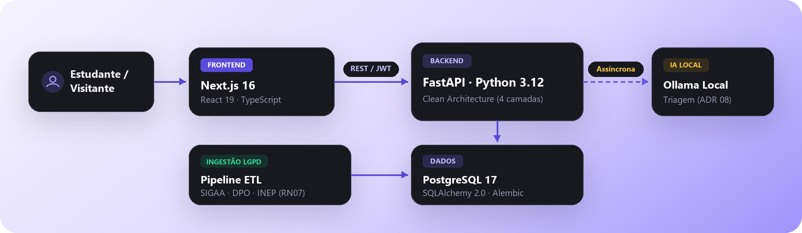

<p align="center">
  <a href="https://unb-mds.github.io/2026-02-TambureteiUnB/">
    
  </a>
</p>

# Tamburetei UnB

Plataforma aberta e colaborativa de inteligência acadêmica para análise de indicadores de aprovação, evasão institucional, matrizes curriculares e repositório comunitário das disciplinas da **Universidade de Brasília (UnB)**, em estrita conformidade com a **LGPD (*Privacy by Design*)**.

---

## 1. Status do Projeto e Badges

[](https://github.com/unb-mds/2026-02-TambureteiUnB/actions/workflows/ci.yml)
[](https://tambureteiunb.com.br/)
[](https://unb-mds.github.io/2026-02-TambureteiUnB/)
[](./LICENSE)


---

## 2. Sumário

1. [Status do Projeto e Badges](#1-status-do-projeto-e-badges)
2. [Sumário](#2-sumário)
3. [Sobre o Projeto](#3-sobre-o-projeto)
4. [Funcionalidades](#4-funcionalidades)
5. [Demonstração](#5-demonstração)
6. [Tecnologias Utilizadas](#6-tecnologias-utilizadas)
7. [Arquitetura](#7-arquitetura)
8. [Estrutura do Projeto](#8-estrutura-do-projeto)
9. [Instalação e Execução](#9-instalação-e-execução)
10. [Configuração de Ambiente](#10-configuração-de-ambiente)
11. [Testes e Qualidade](#11-testes-e-qualidade)
12. [Fontes de Dados e Limitações](#12-fontes-de-dados-e-limitações)
13. [Segurança e Privacidade](#13-segurança-e-privacidade)
14. [Como Contribuir](#14-como-contribuir)
15. [Roadmap](#15-roadmap)
16. [Licença, Créditos e Agradecimentos](#16-licença-créditos-e-agradecimentos)
17. [Equipe](#17-equipe)

---

## 3. Sobre o Projeto

O **Tamburetei UnB** é um projeto de engenharia de software e análise de dados acadêmicos concebido para transformar registros públicos e dispersos da Universidade de Brasília em informações abertas, auditáveis e diretamente úteis para a tomada de decisão de estudantes e docentes.

### O Problema
Na rotina acadêmica da UnB, os sistemas transacionais institucionais (como SIGAA e Matrícula Web) operam como plataformas de registro administrativo, mas não fornecem visibilidade analítica ao estudante no momento da matrícula. Isso gera:
* **Decisões de matrícula às cegas:** desconhecimento de taxas históricas reais de aprovação, reprovação e trancamento por disciplina e turma.
* **Perda e dispersão de material pedagógico:** listas de exercícios, resumos e provas anteriores dispersos em grupos temporários de mensagens sem preservação do conhecimento acumulado.
* **Planejamento manual suscetível a erros:** choque de horários e dificuldade no mapeamento de cadeias de pré-requisitos entre períodos letivos.

### O Propósito e a Relação com a UnB
O Tamburetei estrutura dados históricos obtidos via **Lei de Acesso à Informação (LAI)**, repositórios públicos do **Decanato de Planejamento, Orçamento e Avaliação Institucional (DPO/UnB)** e portais abertos do **SIGAA**, combinando governança de dados com ferramentas práticas de planejamento pessoal.

### Público-Alvo
* **Visitantes, vestibulandos e calouros:** consultam indicadores históricos de desempenho, notas de corte do PAS, ementas, matrizes de cursos e materiais públicos sem obrigatoriedade de cadastro.
* **Estudantes da UnB (autenticados):** planejam sua grade semanal sem choques de horário, importam o Histórico Escolar do SIGAA para acompanhar sua integralização, enviam avaliações de turmas e compartilham materiais com pseudônimos seguros.
* **Docentes, curadores e moderadores:** acompanham a evolução histórica agregada de componentes curriculares e gerenciam a fila administrativa de denúncias e qualidade de arquivos.

---

## 4. Funcionalidades

### 1. Inteligência e Indicadores Acadêmicos
* **Série Histórica de Desempenho:** Percentuais consolidados de aprovação, reprovação por nota, reprovação por falta e trancamentos, apresentados em gráficos de rosca e histogramas semestrais em barras empilhadas.
* **Proteção por Amostragem Mínima:** Regra automática de supressão para turmas com menos de 5 alunos matriculados, prevenindo reidentificação individual em conformidade com a LGPD e a RN07 da UnB.
* **Painel Institucional e Evasão:** Visualização da taxa de evasão anual por curso e campus, notas de corte históricas do PAS e taxas de formação.
* **Exportação Aberta:** Download de datasets tabulares agregados em formatos CSV e JSON para auditoria e pesquisa acadêmica.

### 2. Catálogo Curricular e Hub de Disciplinas
* **Matrizes Curriculares e Fluxos:** Visualização detalhada de cursos da FCTE (Engenharia de Software, Aeroespacial, Automotiva, Eletrônica e Energia), discriminando cargas horárias obrigatórias e optativas.
* **Links Oficiais Homologados:** Acesso direto à grade curricular vigente no portal público do SIGAA para os 161 cursos da universidade.
* **Grafo de Pré-Requisitos:** Mapeamento estruturado e navegável de dependências e co-requisitos por código oficial.

### 3. Planejamento Semanal de Grade (`/minha-grade`)
* **Montagem de Horários sem Conflito:** Algoritmo combinatório que analisa códigos oficiais de turmas da UnB (M, T e N) e sugere alternativas sem choques de horário.
* **Visualização Semanal Integrada:** Quadro de horários em modo escuro com identificação de docentes, turmas e salas.
* **Exportação em PDF:** Geração de documento de grade formatado para acompanhamento durante o período de matrícula.

### 4. Perfil Acadêmico e Doação de Dados (`/perfil`)
* **Parser de Histórico Escolar (PDF):** Leitura local e segura do Histórico Escolar Simplificado do SIGAA para mapeamento visual de matérias concluídas, em andamento e pendentes.
* **Crowdsourcing de Estatísticas de Turmas:** Fluxo de contribuição em que o estudante seleciona uma turma validada pelo Histórico Escolar importado e envia o print do gráfico de pizza do SIGAA (opcional) ou informa os percentuais de aprovação, reprovação por nota, por falta e trancamento (com tolerância de soma entre `99,8%` e `100,2%` para arredondamentos do SIGAA), seguindo para curadoria humana com selo visual de consenso a partir de 5 envios manuais idênticos.

### 5. Repositório Comunitário e Moderação
* **Compartilhamento de Materiais:** Upload e download de provas anteriores, resumos e listas, com validação de extensão (PDF, PNG, JPG), limite de tamanho (5 MiB) e verificação de integridade MIME.
* **Relatos sob Pseudônimo:** Espaço de comentários com pseudônimos gerados de forma anônima e irreversível (*Privacy by Design*).
* **Fila de Moderação e Denúncias:** Mecanismo comunitário de reporte de abusos com esteira administrativa de curadoria humana apoiada por triagem local via LLM (Ollama).

---

## 5. Demonstração

<p align="center">
  
  <br />
  <em>Interface do Tamburetei UnB: catálogo de disciplinas, planejamento semanal de grade e painel de desempenho histórico.</em>
</p>

### Links Oficiais e Ambientes
* **Aplicação em Produção:** [https://tambureteiunb.com.br/](https://tambureteiunb.com.br/)
* **Portal de Documentação Técnica (MkDocs):** [https://unb-mds.github.io/2026-02-TambureteiUnB/](https://unb-mds.github.io/2026-02-TambureteiUnB/)
* **Protótipo Interativo no Figma:** [Template MDS — Grupo 9](https://www.figma.com/board/coZ3FgGpd5amxJxaanwaTr/Template-MDS---Grupo-9?node-id=2128-1592)

---

## 6. Tecnologias Utilizadas

### Frontend
* **Next.js 16.3.4 (App Router)** e **React 19.2.8**
* **TypeScript** com checagem estrita de tipos
* **Tailwind CSS v4** e PostCSS
* **jsPDF 4.2.1** e **html-to-image 1.11.13** para exportação de grade em PDF

### Backend
* **Python 3.12** com **FastAPI >= 0.110.0**
* **SQLAlchemy >= 2.0.28** (ORM assíncrono e síncrono)
* **Alembic >= 1.13.1** para migrações relacionais
* **Pydantic v2** e `pydantic-settings` para validação de esquemas e contratos de dados
* **python-jose** e **bcrypt** para autenticação JWT e hashing seguro de senhas
* **pypdf >= 4.0.0** e **BeautifulSoup4** para parsing de históricos e dados tabulares

### Banco de Dados & Armazenamento
* **PostgreSQL 17** (instância primária de persistência relacional)
* **Volumes Docker** dedicados para isolamento de arquivos enviados pela comunidade (`materiais_data` e `pizzas_data`) e dados do banco (`pgdata`)

### Infraestrutura, Testes & DevOps
* **Docker & Docker Compose** (orquestração de múltiplos contêineres)
* **GitHub Actions** (pipeline de CI com testes, cobertura, análise de mutação e linters)
* **SonarCloud** (análise estática de código e métricas de qualidade)
* **Ruff** e **Bandit** (linting, formatação e análise estática de segurança em Python)
* **Pytest**, `pytest-cov` e **Mutmut** (testes unitários, de integração e mutação no backend)
* **Node Test Runner nativo** (`node --test`) com `tsx` para testes no frontend
* **MkDocs Material** para geração do portal estático de documentação

---

## 7. Arquitetura

O sistema adota os princípios de **Clean Architecture**, estabelecendo um isolamento estrito entre entidades de domínio, regras de negócio de aplicação e mecanismos de entrega e persistência externa.

<p align="center">
  
</p>

### Fluxo de Comunicação entre Componentes
1. **Cliente Web (Next.js):** Consome a API RESTful do backend de forma assíncrona via HTTP/JSON, gerenciando autenticação por Bearer Tokens (JWT).
2. **Camada de API (FastAPI):** Expõe roteadores em `backend/app/api/routers/`, validando payloads com esquemas Pydantic e delegando a execução para os serviços de aplicação.
3. **Serviços de Domínio:** Orquestram as regras de negócio (cálculo de quórum e consenso de doações, validação de limites de arquivos e geração de pseudônimos irreversíveis).
4. **Persistência Relacional:** O SQLAlchemy gerencia conexões transacionais com o PostgreSQL 17. Migrações estruturais de esquema são versionadas pelo Alembic.

---

## 8. Estrutura do Projeto

Árvore representativa dos principais diretórios e arquivos do repositório:

```text
2026-02-TambureteiUnB/
├── .github/                      # Workflows de CI/CD (ci.yml, deploy-docs.yml) e templates de issue
├── backend/                      # Aplicação back-end em Python e FastAPI
│   ├── alembic/                  # Scripts e versões de migrações do banco de dados
│   ├── app/                      # Código-fonte da aplicação
│   │   ├── api/                  # Roteadores HTTP, dependências e esquemas Pydantic
│   │   ├── domain/               # Entidades e regras de negócio centrais
│   │   ├── models/               # Modelos relacionais SQLAlchemy
│   │   ├── pipeline/             # Scripts e CLI do pipeline de ETL de dados abertos
│   │   ├── repositories/         # Camada de acesso a dados
│   │   ├── services/             # Lógica de aplicação e serviços
│   │   └── main.py               # Ponto de entrada da API FastAPI
│   ├── tests/                    # Suíte de testes unitários e de integração
│   ├── Dockerfile                # Configuração do contêiner backend
│   └── requirements.txt          # Dependências do Python
├── docs/                         # Documentação completa em Markdown para o MkDocs
│   ├── assets/                   # Imagens, logos e diagramas arquiteturais
│   ├── comecando/                # Tutoriais de ambiente e contribuição
│   ├── engenharia/               # Documentos de arquitetura, ADRs, banco e deploy
│   ├── produto/                  # Requisitos, regras de negócio e gestão ágil
│   └── releases/                 # Notas de versão das sprints e releases
├── frontend/                     # Aplicação front-end em Next.js e TypeScript
│   ├── public/                   # Recursos estáticos servidos diretamente
│   ├── src/
│   │   ├── app/                  # Rotas do Next.js App Router (páginas e layouts)
│   │   ├── components/           # Componentes visuais reutilizáveis React
│   │   ├── services/             # Clientes HTTP e integração com a API
│   │   ├── types/                # Definições de interfaces e tipos TypeScript
│   │   └── utils/                # Funções utilitárias e validações
│   ├── package.json              # Scripts e dependências do Node.js
│   └── tsconfig.json             # Configurações do compilador TypeScript
├── docker-compose.yml            # Orquestração local dos serviços (db, backend, adminer)
├── docker-compose.prod.yml       # Orquestração para ambiente de produção
├── mkdocs.yml                    # Configurações do portal de documentação MkDocs
└── README.md                     # Apresentação principal do projeto
```

### Documentação Técnica e Documentos de Referência
* **[Documento de Visão](docs/index.md):** Contexto do problema, objetivos e escopo do sistema.
* **[Requisitos](docs/produto/requisitos.md), [Regras de Negócio](docs/produto/regras_negocio.md) & [Relatório Final](docs/produto/relatorio_final.md):** Especificação funcional, governança e consolidação das entregas.
* **[Arquitetura & ADRs](docs/engenharia/arquitetura.md) & [Dicionário de Dados](docs/engenharia/banco_de_dados.md):** Visão C4, decisões arquiteturais e modelagem do PostgreSQL 17.
* **[Pipeline ETL](docs/engenharia/pipeline_etl.md) & [Como Popular o Banco](docs/comecando/popular_banco_de_dados.md):** Ingestão e anonimização dos dados históricos da UnB.
* **[Guia de Desenvolvimento](docs/comecando/desenvolvimento.md), [Deploy](docs/engenharia/deploy.md) & [Uso de IA](docs/ai/ai_usage.md):** Setup local, infraestrutura em produção e governança com `AGENTS.md`.
* **[Histórico de Versões (CHANGELOG)](./CHANGELOG.md):** Registro consolidado das releases do projeto.

---

## 9. Instalação e Execução

### Pré-requisitos
* **Docker** (versão 24.0 ou superior) e **Docker Compose**
* **Git** instalado no sistema operacional
* *(Opcional para desenvolvimento sem Docker)*: Node.js 20+ LTS e Python 3.12+

### Passo a Passo de Execução com Docker (Recomendado)

O arquivo `docker-compose.yml` orquestra os serviços essenciais de infraestrutura: o banco de dados (`db` - PostgreSQL 17), a API do backend (`backend` - FastAPI) e a interface administrativa do banco (`adminer`). O cliente web (`frontend`) é executado em ambiente Node.js dedicado.

1. **Clonar o Repositório:**
   ```bash
   git clone https://github.com/unb-mds/2026-02-TambureteiUnB.git
   cd 2026-02-TambureteiUnB
   ```

2. **Configurar as Variáveis de Ambiente:**
   ```bash
   cp .env.example .env
   ```

3. **Subir os Serviços com Docker Compose (Banco, Backend e Adminer):**
   ```bash
   docker compose up -d --build
   ```

4. **Executar as Migrações do Banco:**
   ```bash
   docker compose exec backend alembic upgrade head
   ```

5. **Iniciar a Aplicação Frontend (Next.js):**
   ```bash
   cd frontend
   npm install
   npm run dev
   ```

6. **Acessar as Aplicações e Serviços:**
   * **Frontend (Aplicação Web):** [http://localhost:3000](http://localhost:3000)
   * **Documentação Interativa da API (Swagger):** [http://localhost:8000/docs](http://localhost:8000/docs)
   * **Gerenciador de Banco de Dados (Adminer):** [http://localhost:8085](http://localhost:8085)

### Execução em Modo de Produção
Para inicializar o ambiente de produção localmente ou em servidor de deploy:
```bash
docker compose -f docker-compose.prod.yml up -d --build
```

---

## 10. Configuração de Ambiente

As configurações do projeto são gerenciadas por variáveis de ambiente declaradas no arquivo `.env`. A tabela abaixo lista os parâmetros presentes no arquivo `.env.example`:

| Variável | Finalidade | Obrigatória no Docker Local? | Padrão / Exemplo |
| :--- | :--- | :---: | :--- |
| `POSTGRES_USER` | Usuário de autenticação no PostgreSQL | Sim | `tamburetei_dev` |
| `POSTGRES_PASSWORD` | Senha de acesso ao banco de dados | Sim | `postgres` |
| `POSTGRES_DB` | Nome do banco de dados relacional | Sim | `tamburetei_db` |
| `POSTGRES_PORT` | Porta de conexão do PostgreSQL | Não | `5432` |
| `POSTGRES_SERVER` | Hostname do contêiner de banco | Sim | `db` |
| `SECRET_KEY` | Chave criptográfica para geração de tokens JWT | Sim | *(Chave segura e privada)* |
| `HISTORICO_DEDUP_SECRET` | Chave para hashing de deduplicação de históricos | Não | Vazia (usa `SECRET_KEY`) |
| `MATERIAL_MAX_BYTES` | Tamanho máximo por arquivo anexado | Não | `5242880` (5 MiB) |
| `QUORUM_MINIMO_DOACOES`| Número mínimo de doações para consolidar turma | Não | `3` |
| `OLLAMA_BASE_URL` | URL do servidor Ollama para moderação por IA | Não | `http://host.docker.internal:11434` |
| `OLLAMA_MODEL` | Modelo LLM local para classificação de texto | Não | `qwen2.5:3b` |
| `OLLAMA_VISION_MODEL` | Modelo de visão multimodal no Ollama | Não | *(Vazio por padrão)* |
| `OLLAMA_TIMEOUT_SECONDS` | Timeout das requisições ao Ollama (em segundos) | Não | `90.0` |
| `MODERATION_CONFIDENCE_THRESHOLD` | Confiança mínima para triagem automática de materiais | Não | `0.80` |
| `ENVIRONMENT` | Identificador do ambiente de execução | Não | `development` |
| `BACKEND_CORS_ORIGINS` | Origens autorizadas para requisições no backend | Sim | `http://localhost:3000` |
| `NEXT_PUBLIC_API_URL` | URL base da API consumida pelo frontend | Sim | `http://localhost:8000` |
| `SMTP_HOST` | Host do provedor SMTP para envio de e-mails | Não | `smtp.gmail.com` |
| `SMTP_PORT` | Porta do serviço SMTP | Não | `587` |
| `SMTP_USER` | Conta de usuário no serviço SMTP | Não | `tambureteiunb@gmail.com` |
| `SMTP_PASSWORD` | Senha de aplicativo no serviço SMTP | Não | *(Senha de app Google)* |
| `SMTP_FROM_EMAIL` | Endereço remetente exibido nos e-mails transacionais | Não | `tambureteiunb@gmail.com` |
| `SMTP_FROM_NAME` | Nome remetente exibido nos e-mails transacionais | Não | `"Tamburetei UnB"` |
| `SMTP_TLS` | Habilita STARTTLS na conexão SMTP | Não | `true` |
| `SMTP_SSL` | Habilita SSL implícito na conexão SMTP | Não | `false` |
| `FRONTEND_URL` | URL base do cliente web para links em e-mails | Não | `http://localhost:3000` |

---

## 11. Testes e Qualidade

O projeto utiliza esteiras contínuas de validação com cobertura de testes automatizados e critérios de qualidade estritos definidos no pipeline de CI (`.github/workflows/ci.yml`).

### Testes do Backend (Python / Pytest)
```bash
# Executar a suíte de testes no contêiner
docker compose exec backend pytest -v

# Executar testes com relatório e meta mínima de 70% de cobertura
docker compose exec backend pytest --cov=app --cov-report=term-missing --cov-fail-under=70

# Executar análise de mutação (meta mínima de 50% no CI)
docker compose exec backend mutmut run --no-progress

# Verificação de linter (Ruff) e segurança estática (Bandit)
docker compose exec backend ruff check app tests
docker compose exec backend bandit -r app -ll
```

### Testes e Validação do Frontend (Node.js / Next.js)
```bash
cd frontend

# Executar testes unitários automatizados
npm test

# Verificação estática de tipos TypeScript
npx tsc --noEmit

# Executar o linter oficial do Next.js/ESLint
npm run lint

# Validar o build de produção
npm run build
```

### Validação do Portal MkDocs
```bash
# Servir documentação com live-reload na porta 8001
mkdocs serve -a localhost:8001
```

---

## 12. Fontes de Dados e Limitações

### Origem das Informações
1. **Dados Oficiais (LAI e DPO):** Registros estatísticos de aprovação, reprovação e retenção obtidos via pedidos formais pela Lei de Acesso à Informação e relatórios do [Anuário Estatístico UnB (DPO)](https://repositoriodpo.unb.br/anuarios/anuario-estatistico-2025/).
2. **Dados Públicos Estruturados (SIGAA):** Catálogo curricular e estruturas de turmas mapeados diretamente do portal público da universidade.
3. **Dados Colaborativos (Crowdsourcing):** Percentuais de desempenho e turmas informados por estudantes autenticados, consolidados somente após atingirem o quórum mínimo de conferência.
4. **Arquivos Comunitários:** Provas anteriores e sínteses conceituais compartilhadas voluntariamente por usuários.

### Limitações Conhecidas
* **Janelas de Atualização:** Os dados oficiais obtidos via LAI correspondem a recortes históricos fechados e consolidados, podendo apresentar defasagem em relação ao semestre letivo imediatamente em andamento.
* **Cobertura de Turmas:** Turmas de disciplinas muito recentes ou com alterações curriculares recentes podem depender de doações colaborativas da comunidade para formar o histórico completo.

---

## 13. Segurança e Privacidade

O Tamburetei UnB adota como premissa a conformidade técnica com a **Lei Geral de Proteção de Dados (LGPD - Lei nº 13.709/2018)** por meio de estratégias de *Privacy by Design*:

* **Anonimização e Supressão:** Dados de turmas com amostragem inferior a 5 alunos são automaticamente agregados para impedir qualquer identificação indireta de indivíduos.
* **Pseudonimização Irreversível:** Comentários e vivências acadêmicas são identificados por pseudônimos randômicos gerados via hash com salt criptográfico, desvinculando o texto público do ID real da conta do usuário.
* **Privacidade no Histórico:** O upload do PDF do Histórico Escolar é processado para extração dos códigos de disciplinas cursadas e seus créditos, sem armazenar dados pessoais do estudante em banco.
* **Canal para Relato de Vulnerabilidades:** Diretrizes de segurança e canal de contato para divulgação responsável de falhas estão documentados em [SECURITY.md](./SECURITY.md).

---

## 14. Como Contribuir

Contribuições da comunidade e de novos desenvolvedores são muito bem-vindas. Para manter a estabilidade arquitetural e a conformidade técnica do projeto:

1. Consulte o **[Guia de Contribuição (CONTRIBUTING.md)](./CONTRIBUTING.md)** para conhecer o padrão arquitetural (Clean Architecture), o fluxo de branches Gitflow (`develop` para desenvolvimento contínuo e `main` para versões de release) e as regras do CI.
2. Respeite as diretrizes de convivência do **[Código de Conduta (CODE_OF_CONDUCT.md)](./CODE_OF_CONDUCT.md)**.
3. Utilize o padrão **Conventional Commits** e mantenha a política de **ausência estrita de emojis** em mensagens de commit, branches, PRs e documentações (`AGENTS.md`).

### Fluxo Rápido de Contribuição
1. Crie um fork do repositório no GitHub.
2. Crie uma branch a partir da `develop` atualizada (`git checkout -b feat/nome-da-funcionalidade`).
3. Desenvolva as alterações acompanhadas dos testes unitários correspondentes.
4. Certifique-se de que `npm test`, `npx tsc --noEmit` e os testes do backend passaram com sucesso.
5. Abra uma Pull Request apontando para a branch `develop`.

---

## 15. Roadmap

Funcionalidades em desenvolvimento e marcos planejados pelo time de desenvolvimento:

* [x] **Release 1 (R1):** Pipeline de ETL de dados abertos da LAI, modelagem relacional PostgreSQL 17, autenticação JWT e catálogo de cursos e disciplinas.
* [x] **Release 2 (R2):** Hub completo de disciplinas, visualizador de pré-requisitos, motor de montagem de grade sem choques de horário (`/minha-grade`), parser de histórico escolar, repositório de materiais com moderação e painel institucional.
* [ ] **Próximos Passos Consolidados:**
  - Ampliação da cobertura de quóruns colaborativos de turmas para os campi Darcy Ribeiro, Ceilândia e Planaltina.
  - Implementação de filtros avançados por departamento e turno no catálogo analítico.
  - Otimizações contínuas de acessibilidade e conformidade WCAG 2.1 no portal web.

---

## 16. Licença, Créditos e Agradecimentos

### Licença
Este projeto é distribuído sob os termos da **[Licença MIT](./LICENSE)**. Qualquer pessoa tem permissão para usar, copiar, modificar e redistribuir o software livremente, preservando os devidos créditos aos autores originais.

### Créditos e Inspiração
* **[Tamburetei (OpenDevUFCG)](https://github.com/OpenDevUFCG/tamburetei):** Projeto pioneiro idealizado pela comunidade OpenDev da Universidade Federal de Campina Grande, que serviu como inspiração conceitual para o desenvolvimento desta plataforma na UnB.
* **Universidade de Brasília (UnB):** Pela disponibilização pública de indicadores por meio do Serviço de Informação ao Cidadão (SIC/LAI) e do Decanato de Planejamento, Orçamento e Avaliação Institucional (DPO).

---

## 17. Equipe

Desenvolvedores responsáveis pela criação e manutenção do projeto:

| Foto de Perfil | Nome do Integrante | Link do GitHub |
| :---: | :--- | :---: |
|  | **Bruno Cauê Souza Lopes Oliveira** | [](https://github.com/bcaueLPS) |
|  | **Gabriel Di Angellis Basilio Ferreira** | [](https://github.com/diangellis) |
|  | **Luis Guilherme de Almeida Costa** | [](https://github.com/LuisGuilherme67) |
|  | **Lucas Miranda Souza** | [](https://github.com/lucasssmira) |
|  | **Luiza Carneiro Carvalho** | [](https://github.com/LuizaCarvalho691) |
|  | **Maria Vitória Queiroz Lima** | [](https://github.com/mariav-07) |
|  | **Thamires Ellen Souza Araujo** | [](https://github.com/thamiresellensa) |
