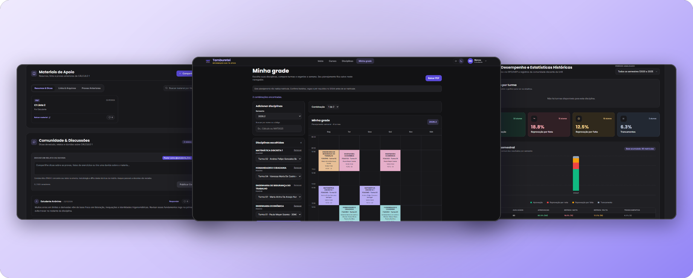

<p align="center">
  <a href="https://unb-mds.github.io/2026-02-TambureteiUnB/">
    
  </a>
</p>

# Tamburetei UnB

Plataforma aberta e colaborativa de inteligência acadêmica para análise de indicadores de aprovação, evasão institucional, matrizes curriculares e repositório comunitário das disciplinas da **Universidade de Brasília (UnB)**, em estrita conformidade com a **LGPD (*Privacy by Design*)**.

---

## 1. Status do Projeto e Badges

[](https://github.com/unb-mds/2026-02-TambureteiUnB/actions/workflows/ci.yml)
[](https://tambureteiunb.com.br/)
[](https://unb-mds.github.io/2026-02-TambureteiUnB/)
[](LICENSE)


[Aplicação em Produção](https://tambureteiunb.com.br/) · [Documentação Oficial](https://unb-mds.github.io/2026-02-TambureteiUnB/) · [Pré-requisitos e Instalação](#4-pré-requisitos-e-instalação) · [Como Usar](#5-como-usar) · [Arquitetura](#6-arquitetura-em-camadas) · [Como Contribuir](#7-como-contribuir) · [Licença](#8-licença) · [Equipe](#9-equipe)

---

## 2. Descrição e Propósito

O **Tamburetei UnB** é um projeto de análise de dados acadêmicos concebido para transformar registros dispersos da universidade em informações públicas, transparentes e reprodutíveis. 

Historicamente, estudantes da UnB enfrentavam dificuldades para planejar suas matrículas semestrais, desconhecendo taxas reais de aprovação por turma, históricos de retenção e ementas práticas das disciplinas. O Tamburetei consolida dados obtidos por meio da **Lei de Acesso à Informação (LAI)**, do **SIGAA** e do **DPO/UnB**, integrando indicadores objetivos a uma experiência comunitária colaborativa.

O projeto concluiu os entregáveis da **Release 1 (R1)** (Pipeline de ETL e anonimização LGPD, modelagem relacional PostgreSQL 17, autenticação JWT e catálogo curricular) e consolidou na **Release 2 (R2)** o portal web em Next.js, doações colaborativas por quórum, upload e curadoria de materiais, Central de Denúncias (RN04), triagem híbrida por IA local (Ollama) e dashboard institucional.

O projeto é inspirado no **Tamburetei**, concebido originalmente pela OpenDevUFCG, adaptando o conceito para o ecossistema e as normas acadêmicas da Universidade de Brasília.

### Módulos Principais
* **Indicadores Acadêmicos:** Taxas históricas de aprovação, reprovação por nota, reprovação por falta e trancamentos agregadas por quórum mínimo (LGPD).
* **Painel Institucional:** Indicadores de evasão anual por curso e campus, fluxos curriculares e notas de corte consolidadas do PAS (Cebraspe).
* **Planejamento Semanal (`/minha-grade`):** Montagem interativa de grade horária com detecção automática de choques de horário e exportação em PDF.
* **Hub Colaborativo de Materiais:** Compartilhamento e curadoria de materiais de apoio (PDF, PNG, JPG) com triagem por IA local e aprovação humana.
* **Comentários sob Pseudônimo:** Discussões e relatos de turmas sob pseudônimo seguro (*Privacy by Design*) e Central de Denúncias (`RN04`).

### Público-Alvo
* **Visitantes e calouros:** consultam livremente indicadores históricos, notas de corte do PAS, grades curriculares, ementas, materiais públicos e comentários sem necessidade de cadastro.
* **Estudantes da UnB (autenticados):** registram situação nas disciplinas ("Já cursei"), contribuem com estatísticas de turmas, enviam materiais e comentários sob pseudônimo, importam o histórico do SIGAA e montam sua grade semanal.
* **Moderadores e curadores:** revisam materiais, comentários e denúncias (`RN04`) na fila administrativa, com apoio da triagem híbrida por IA local.

---

## 3. Demonstração

<p align="center">
  
  <br />
  <em>Interface do Tamburetei UnB: catálogo de disciplinas, planejamento semanal de grade e painel de desempenho histórico.</em>
</p>

### Links Úteis de Navegação
* **Ambiente em Produção:** [tambureteiunb.com.br](https://tambureteiunb.com.br/)
* **Portal de Documentação (MkDocs):** [unb-mds.github.io/2026-02-TambureteiUnB](https://unb-mds.github.io/2026-02-TambureteiUnB/)
* **Protótipo Interativo no Figma:** [Template MDS — Grupo 9](https://www.figma.com/board/coZ3FgGpd5amxJxaanwaTr/Template-MDS---Grupo-9?node-id=2128-1592)

---

## 4. Pré-requisitos e Instalação

### Pré-requisitos do Sistema
* **Docker & Docker Compose** (versão 24.0+ recomendada)
* **Git** (para versionamento e clonagem)
* *(Opcional para execução nativa)*: **Python 3.12+** e **Node.js 20+ / 22+ LTS** com npm

### Passo a Passo de Execução Rápida (Quickstart com Docker)

1. **Clonar o Repositório:**
   ```bash
   git clone https://github.com/unb-mds/2026-02-TambureteiUnB.git
   cd 2026-02-TambureteiUnB
   ```

2. **Configurar as Variáveis de Ambiente:**
   ```bash
   cp .env.example .env
   ```

3. **Subir a Stack Completa via Docker Compose:**
   ```bash
   docker compose up -d --build
   ```

4. **Acessar os Serviços Locais:**
   * **Frontend (Next.js):** [http://localhost:3000](http://localhost:3000)
   * **Backend API (Swagger Docs):** [http://localhost:8000/docs](http://localhost:8000/docs)
   * **Gerenciador de Banco (Adminer):** [http://localhost:8085](http://localhost:8085)

---

## 5. Como Usar

### Execução em Produção
Para provisionar a stack com contêineres de produção otimizados:
```bash
docker compose -f docker-compose.prod.yml up -d --build
```

### Comandos de Teste e Qualidade

#### Testes do Backend (Pytest + Cobertura + Mutação)
```bash
# Executar a suíte completa de testes no Docker
docker compose exec backend pytest -v

# Executar testes unitários
docker compose exec backend pytest tests/unit -v

# Executar testes de integração
docker compose exec backend pytest tests/integration -v

# Executar testes com relatório de cobertura de código
docker compose exec backend pytest --cov=app --cov-report=term-missing --cov-fail-under=70

# Executar testes de mutação com Mutmut
docker compose exec backend mutmut run
```

#### Testes e Verificação do Frontend
```bash
cd frontend

# Executar suíte de testes unitários automatizados
npm test

# Verificação estática de tipos TypeScript
npx tsc --noEmit

# Executar linter de código
npm run lint

# Gerar build de produção
npm run build
```

#### Migrações de Banco de Dados com Alembic
```bash
# Aplicar migrações pendentes no banco
docker compose exec backend alembic upgrade head

# Gerar nova migração após alterar modelos SQLAlchemy
docker compose exec backend alembic revision --autogenerate -m "nome_da_migracao"
```

---

## 6. Arquitetura em Camadas

O sistema adota os princípios de **Clean Architecture**, garantindo desacoplamento entre regras de domínio, orquestração e interfaces externas:

<p align="center">
  
</p>

### Documentação Detalhada em `docs/`
* **[Documento de Visão](docs/index.md):** Contexto do problema, objetivos, valor entregue, fluxo de navegação e escopo.
* **[Guia de Contribuição](CONTRIBUTING.md), [Como Contribuir](docs/comecando/como_contribuir.md) & [Código de Conduta](CODE_OF_CONDUCT.md):** Fluxo de branches, TDD, Conventional Commits, portas de qualidade do CI e diretrizes da comunidade.
* **[Gestão Ágil, Sprints e Rastreabilidade](docs/produto/gestao_agil.md) & [Histórico de Versões](CHANGELOG.md):** Story Map no Figma, atas de reunião, milestones e evolução consolidada por release.
* **[Requisitos do Sistema](docs/produto/requisitos.md) & [Regras de Negócio](docs/produto/regras_negocio.md):** Requisitos funcionais, não funcionais e políticas de governança e anonimização.
* **[Arquitetura do Sistema & ADRs](docs/engenharia/arquitetura.md):** Visão arquitetural C4, Clean Architecture, diagramas de sequência de ponta a ponta e registros de decisões arquiteturais (ADRs 01 a 08).
* **[Dicionário de Dados Relacional](docs/engenharia/banco_de_dados.md):** Mapa de relacionamentos e detalhamento dos esquemas do PostgreSQL 17 (17 tabelas + 1 Materialized View).
* **[Dashboard Institucional](docs/engenharia/dashboard_institucional.md) & [Autenticação e Comunidade](docs/engenharia/autenticacao_comunidade.md):** Contratos e regras de domínio do painel institucional (Épico 6), segurança JWT/RBAC e relatos sob pseudônimo.
* **[Pipeline de Dados & ETL](docs/engenharia/pipeline_etl.md) e [Como Popular o Banco](docs/comecando/popular_banco_de_dados.md):** Passo a passo para ingestão, anonimização e carga de dados de turmas, docentes e históricos.
* **[Deploy e Infraestrutura](docs/engenharia/deploy.md):** Provisionamento de produção via Docker Compose, Caddy e Cloudflare.
* **[Guia de Desenvolvimento e Smoke Test](docs/comecando/desenvolvimento.md):** Configuração de ambiente, comandos de execução, linter, testes e roteiro de validação de fumaça (*smoke test*).
* **[Uso de IA & Governança de Agentes](docs/ai/ai_usage.md):** Diretrizes do `AGENTS.md`, skills do projeto e fluxo de trabalho assistido por IA.

Para rodar o portal MkDocs localmente:
```bash
pip install mkdocs mkdocs-material pymdown-extensions
mkdocs serve -a localhost:8001
```

### Fontes DPO/Anuário
* [Anuário Estatístico UnB 2025 (DPO)](https://repositoriodpo.unb.br/anuarios/anuario-estatistico-2025/) — caso deseje buscar por outro ano, basta alterar o ano na URL.

---

## 7. Como Contribuir

Contribuições da comunidade e de novos desenvolvedores são muito bem-vindas. Para manter a estabilidade arquitetural e a conformidade técnica do projeto:

1. Consulte o **[Guia de Contribuição (CONTRIBUTING.md)](CONTRIBUTING.md)** para conhecer o padrão arquitetural (Clean Architecture), fluxo de branches Gitflow (`develop` para novas features, `main` para releases estáveis) e portas de qualidade.
2. Respeite as diretrizes do **[Código de Conduta (CODE_OF_CONDUCT.md)](CODE_OF_CONDUCT.md)**.
3. Siga o padrão **Conventional Commits** e a política estrita de **ausência de emojis** em mensagens de commit, PRs e documentações (`AGENTS.md`).

---

## 8. Licença

Este projeto é distribuído sob os termos da **[Licença MIT](LICENSE)**. Qualquer pessoa tem permissão para usar, modificar, copiar e redistribuir o software livremente, preservando os devidos créditos aos autores originais.

---

## 9. Equipe

Desenvolvedores responsáveis pela criação e manutenção do projeto:

| Foto de Perfil | Nome do Integrante | Link do GitHub |
| :---: | :--- | :---: |
|  | **Bruno Cauê Souza Lopes Oliveira** | [](https://github.com/bcaueLPS) |
|  | **Gabriel Di Angellis Basilio Ferreira** | [](https://github.com/diangellis) |
|  | **Luis Guilherme de Almeida Costa** | [](https://github.com/LuisGuilherme67) |
|  | **Lucas Miranda Souza** | [](https://github.com/lucasssmira) |
|  | **Luiza Carneiro Carvalho** | [](https://github.com/LuizaCarvalho691) |
|  | **Maria Vitória Queiroz Lima** | [](https://github.com/mariav-07) |
|  | **Thamires Ellen Souza Araujo** | [](https://github.com/thamiresellensa) |
