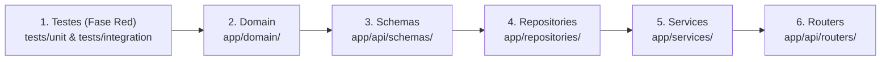

# Como Contribuir

Este guia descreve o processo oficial de contribuição para o **Tamburetei UnB**, cobrindo o fluxo de branches no Git, padrões de commits, ciclo de desenvolvimento orientado a testes (TDD), regras da Clean Architecture e verificações obrigatórias de Integração Contínua (CI).

---

## 1. Fluxo de Branches e Versionamento

O repositório opera com duas branches principais:

* **`main`:** linha estável de entregas de Release. Atualizações na `main` em `docs/` ou `mkdocs.yml` disparam a publicação automática do portal de documentação no GitHub Pages.
* **`develop`:** linha de integração da sprint. Todas as branches de trabalho devem partir da `develop` atualizada e retornar para ela por meio de Pull Request.

### Criando uma nova branch de trabalho

1. Certifique-se de que existe uma **Issue** aberta e atribuída no GitHub para a tarefa.
2. Sincronize a `develop` e crie sua branch com `git switch -c`:
   ```bash
   git switch develop
   git pull origin develop
   git switch -c <tipo>/<nome-da-tarefa>
   ```

| Prefixo | Uso | Exemplo |
| :--- | :--- | :--- |
| `feat/` | Nova funcionalidade ou User Story | `feat/dashboard-geral` |
| `fix/` | Correção de bug ou regressão | `fix/178-ocupacao-real-turmas` |
| `docs/` | Documentação ou estrutura do MkDocs | `docs/estrutura-pastas` |
| `test/` | Criação ou ampliação de testes automatizados | `test/cobertura-dashboard` |
| `chore/` / `ci/` | Infraestrutura, Docker ou workflows de CI | `ci/deploy-mkdocs-material` |

---

## 2. Convenção de Commits e Política de Comunicação

* **Conventional Commits:** utilize os prefixos padronizados (`feat:`, `fix:`, `docs:`, `test:`, `refactor:`, `chore:`, `ci:`).
* **Commits Atômicos:** divida a entrega em commits pequenos e coesos por camada arquitetural (primeiro testes na fase *Red*, depois implementação em *Domain*, *Schemas*, *Repositories*, *Services* e *Routers* na fase *Green*).
* **Sem Emojis (`AGENTS.md`):** não utilize emojis em código-fonte, mensagens de commit, títulos/descrições de PRs, Issues ou páginas de documentação técnica.

---

## 3. Ciclo TDD e Clean Architecture no Backend

O desenvolvimento no backend FastAPI segue estritamente a especificação `specs/backend-architecture-spec.md`:



### Regras de Conformidade por Camada

1. **Routers 100% Declarativos (`app/api/routers/`):** apenas declaram rotas, `response_model`, códigos HTTP e injetam dependências (`Depends`), repassando a execução para `app/services/`. Nunca execute `db.query(...)` ou `db.execute(...)` em um router.
2. **Serviços e Casos de Uso (`app/services/`):** concentram a orquestração de negócio, tratamento de exceções de banco (`SQLAlchemyError` -> HTTP 503) e regras de existência/permissão (`HTTPException` 400, 401, 403, 404, 409).
3. **Domínio Puro (`app/domain/`):** cálculos e validações determinísticas desacopladas de banco e HTTP (ex.: taxas de aprovação, formação, evasão, quórum e ética).
4. **Repositórios (`app/repositories/`):** consultas parametrizadas com SQLAlchemy 2.0, utilizando `selectinload` em relações N:N para evitar consultas N+1.
5. **Schemas em Português (`app/api/schemas/`):** validadores Pydantic v2 utilizando `PydanticCustomError` com mensagens humanizadas em português.
6. **Database-as-Code (`alembic/` — ADR 02):** toda alteração de tabela ou visão materializada deve possuir migração linear no Alembic, sem bifurcação de `heads`.

---

## 4. Checklist de Validação Local (CI Quality Gates)

Antes de abrir o Pull Request, valide todos os critérios cobrados pelo pipeline de CI:

### Backend e Banco de Dados
```bash
docker compose exec backend ruff check app tests
docker compose exec backend bandit -r app -ll
docker compose exec backend alembic upgrade head
docker compose exec backend pytest --cov=app --cov-report=term-missing --cov-fail-under=70
docker compose exec backend mutmut run
```

### Frontend
```bash
cd frontend
npm ci
npm run lint
npx tsc --noEmit
npm test
npm run build
```

### Documentação (MkDocs)
```bash
mkdocs build --strict
```

### Pipeline Automatizado (CI/CD e Qualidade)

| Workflow / Job | Ferramentas e Critérios | Disparo |
| :--- | :--- | :--- |
| `Backend — Lint & SAST` | `Ruff` (lint/estilo) e `Bandit` (`-ll`, SAST) | Push e PR (`ci.yml`) |
| `Backend — Testes, Cobertura & Mutação` | PostgreSQL 17, `alembic upgrade head`, `Pytest` (`>= 70%` cobertura) e `Mutmut` (`>= 50%` mutantes mortos) | Push e PR (`ci.yml`) |
| `Frontend — Lint, Typecheck & Build` | Node 22, `ESLint`, `tsc --noEmit` e `npm run build` (Next.js) | Push e PR (`ci.yml`) |
| `Infra — Docker Compose Build & Healthcheck` | Sobe stack via `docker compose` e valida `GET /health` | Push e PR (`ci.yml`) |
| `Deploy MkDocs to GitHub Pages` | Valida com `mkdocs build --strict` e publica o portal estático | Push na `main` em `docs/**` ou `mkdocs.yml` (`deploy-docs.yml`) |

---

## 5. Revisão de Código (Code Review)

1. Abra o Pull Request apontando para a branch `develop` e preencha todas as seções do template `.github/PULL_REQUEST_TEMPLATE.md`.
2. Vincule a Issue correspondente na seção de rastreabilidade (`Closes #XXX` ou `Relacionado a #XXX`).
3. Solicite a revisão de pelo menos um membro da equipe e aguarde todos os checks automáticos ficarem verdes antes de realizar o merge.
