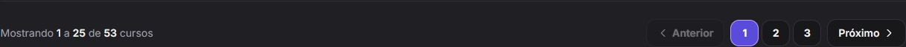

# Paginação de Início e tema dos cards de cursos

## Base da entrega

A captura de Métricas Institucionais corresponde à antiga branch `feat/extracao-metricas-cursos-dpo`, integrada à develop pela PR #212. Esta correção está isolada em `fix/inicio-catalogo-dpo`, sobre a develop atual, preservando os novos cards e dados de matriz curricular.

A PR desta correção tem `develop` como base. A compatibilidade com a integração dos cursos foi conferida antes da publicação.

## Correções

- A superfície `bg-[#FAF9FE]` usa `--surface-muted` no tema escuro, seguindo os demais painéis dos cards nas páginas Início e Cursos. O tema claro conserva sua cor original.
- Início e Cursos compartilham o limite de 25 cursos por página e a função de fatiamento. A navegação reutiliza o componente Pagination existente.
- Busca, troca de campus e limpeza reiniciam a paginação. A troca de página retorna ao início do catálogo.
- O filtro permanece anterior à paginação. A exportação continua recebendo todos os cursos filtrados, não apenas a página visível.
- A sessão inicial usa a assinatura de autenticação existente, sem atualização síncrona de estado no efeito. O teste de renderização usa os provedores reais de tema e roteamento.

## Validação local

- **111 testes do frontend aprovados**.
- ESLint, TypeScript e build de produção aprovados.
- Navegador com 53 cursos simulados: páginas de 25, 25 e 3 itens; pesquisa e campus reiniciando a página; resultado vazio e limpeza; navegação móvel; uma única consulta à lista durante os filtros locais.
- A página Cursos preserva a navegação de 25 itens.
- Fundo institucional escuro: `rgb(32, 32, 36)`, igual à superfície de Matriculados. Fundo claro preservado: `rgb(250, 249, 254)`.
- Tela móvel de 390 pixels sem transbordamento horizontal.

## Rastreabilidade

Sprint planejada: **Sprint 12**. A issue e a PR serão publicadas após revisão.
