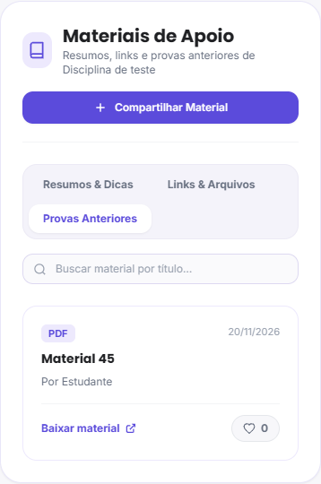

# Materiais públicos: download, paginação e erros

## Correções

A ação Baixar material consulta a rota de arquivo com JWT, recebe um Blob e inicia o download. O endereço temporário é liberado após o uso. Visitantes recebem orientação de login; as falhas retornadas pela API são apresentadas na própria seção.

A listagem envia título, página e tipos ao servidor. O filtro `tipos` permite agrupar RESUMO e DICA; o filtro singular `tipo` continua disponível, mas não pode ser combinado com `tipos`. Tipos inválidos retornam 422. As condições existentes de curadoria e moderação são preservadas.

A interface usa 20 itens por página e o total informado pela API. Busca e categoria reiniciam a página. Respostas de consultas anteriores não sobrescrevem a consulta atual. Uma falha da API tem estado próprio e botão Tentar novamente; resposta vazia continua tendo mensagem de ausência de resultados.

O acompanhamento pós-upload continua consultando os materiais recentes para identificar a publicação, independentemente do filtro da lista que estava aberto.

## Validação local

- Suíte completa do backend: **535 testes aprovados**, com PostgreSQL em banco isolado `_test`.
- **116 testes do frontend aprovados**, incluindo token e conteúdo binário, respostas 401/403/404/503 e parâmetros de consulta.
- Ruff, ESLint dos arquivos alterados, TypeScript e build aprovados.
- Navegador com API simulada: páginas de 20/20/3 itens; pesquisa de material fora da primeira página; download com JWT e conteúdo PDF conferido; resposta antiga descartada; erro 503 e nova tentativa; filtro de provas.
- Testes reais de API confirmam busca global, páginas sem duplicação, categoria RESUMO/DICA, preservação do filtro singular e exclusão de arquivos pendentes.

## Relação com o diagnóstico

O [diagnóstico inicial](diagnostico_bugs_funcionais.md) e suas capturas registram a revisão anterior às correções. Esta entrega corrige download, pesquisa/paginação e tratamento de falhas. Vínculo de comentários e métricas estão em branches próprias.

Branch: `fix/materiais-publicos`. Sprint planejada: **Sprint 12**. Issue e PR dependem da revisão antes da publicação.
