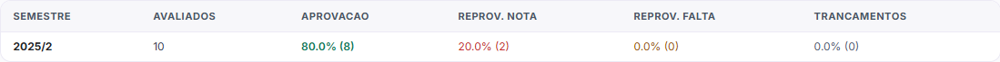

# Métricas reais e ausência de histórico

## Correções

O adaptador distingue zero aprovados com alunos matriculados de ausência de amostra. Taxas numéricas finitas entre 0 e 100 são válidas, incluindo zero. Badges, cartão de detalhe, carregamento complementar e ordenação por aprovação usam a mesma validação.

A página deixa de preencher gráficos e tabelas com o histórico fixo de demonstração. Quando não há períodos públicos, apresenta um estado de ausência de histórico. Registros suprimidos por baixa amostragem continuam filtrados conforme a RN07. Dados reais e exportação permanecem no fluxo existente.

## Validação local

- **116 testes do frontend aprovados**, incluindo validação percentual, adaptação de amostra vazia e apresentação de taxa zero.
- ESLint dos arquivos alterados, TypeScript e build de produção aprovados.
- Navegador com API simulada: taxa zero visível; histórico vazio sem barras ou linhas fictícias; período de três alunos suprimido; série mista com apenas o período público exibido.

## Rastreabilidade

Branch local: `fix/metricas-disciplina`. Sprint planejada: **Sprint 12**. Issue e PR serão publicadas após revisão.
