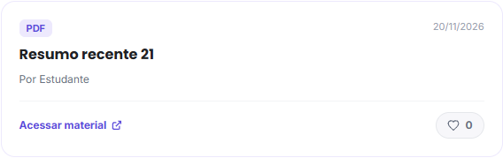
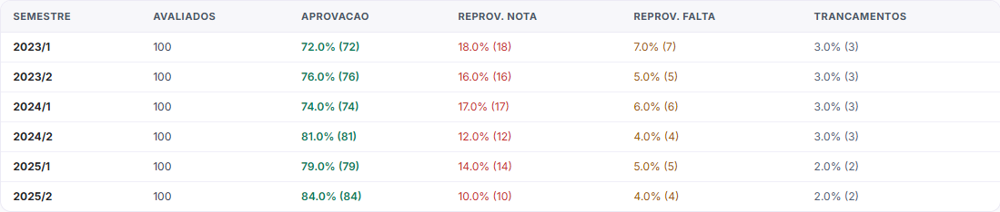
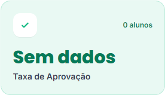

# Diagnóstico de bugs funcionais

## Escopo e estado

Diagnóstico local da `develop`, revisão `d8a28c7207726bae339c661659eec8abb452d44e`, realizado em 21/11/2026.

Os seis problemas abaixo foram reproduzidos. Este documento registra o comportamento anterior às correções; não representa entrega dos fixes nem comprovação de falha no ambiente publicado.

Método: interface real compilada do projeto com respostas controladas de uma API local. O caso de comentários executa o serviço real com repositórios simulados. Nenhum banco é acessado ou alterado. Os números e materiais usados são fictícios e existem somente para reprodução. As capturas são da interface original, sem modificar o DOM para simular os defeitos.

Evidências estruturadas: [resultados.json](assets/diagnostico-bugs/resultados.json).

## Demonstração ao vivo

Com os servidores locais em execução, abrir [painel de demonstração](http://localhost:18004). O painel contém seis casos, a página real do frontend e links para consultar o JSON recebido.

| Caso | Página de demonstração | O que observar |
| --- | --- | --- |
| Download | [Abrir](http://localhost:18004/?caso=download) | Acessar material aponta para `#`. |
| Comentário e turma | [Abrir](http://localhost:18004/?caso=comentario) | Serviço aceita disciplina 10 com turma pertencente à disciplina 20. |
| Histórico | [Abrir](http://localhost:18004/?caso=historico) | Seis semestres aparecem apesar de `metricas: []`. |
| Paginação | [Abrir](http://localhost:18004/?caso=paginacao) | Buscar `Resumo antigo` não encontra o material da página 2. |
| Falha da API | [Abrir](http://localhost:18004/?caso=erro) | Resposta 503 vira mensagem de ausência de materiais. |
| Aprovação zero | [Abrir](http://localhost:18004/?caso=zero) | Cartão apresenta `Sem dados` para uma taxa válida de zero. |

### Iniciar novamente

Na raiz do repositório, usando o ambiente Python com as dependências do backend instaladas:

```powershell
python backend/scripts/demonstrar_bugs.py
```

Em outro terminal:

```powershell
cd frontend
$env:NEXT_PUBLIC_API_URL = 'http://localhost:18004'
npm run build
npm run start -- -p 3006
```

As portas precisam estar livres. A API de demonstração escuta somente em `127.0.0.1:18004`. Seu servidor não implementa criação, edição ou exclusão de registros. Para encerrar, usar Ctrl+C nos dois terminais.

A variável acima configura apenas o terminal e o build de demonstração, sem alterar arquivos `.env`. Para voltar à API habitual, encerrar a demonstração, remover a variável com `Remove-Item Env:NEXT_PUBLIC_API_URL` no terminal em que foi definida e recompilar com a configuração normal do projeto.

## BUG-01 — Acesso a materiais sem download

**Prioridade:** alta. **Camada:** integração frontend/API.

**Código:** [MateriaisApoio.tsx](https://github.com/unb-mds/2026-02-TambureteiUnB/blob/d8a28c7207726bae339c661659eec8abb452d44e/frontend/components/MateriaisApoio.tsx), linhas 86 e 394; [schema de materiais](https://github.com/unb-mds/2026-02-TambureteiUnB/blob/d8a28c7207726bae339c661659eec8abb452d44e/backend/app/api/schemas/material.py), linha 8; [rota de download](https://github.com/unb-mds/2026-02-TambureteiUnB/blob/d8a28c7207726bae339c661659eec8abb452d44e/backend/app/api/routers/materiais.py), linha 56.

O adaptador do componente contém:

```tsx
url: item.url || item.arquivo_url || "#",
```

O botão usa:

```tsx
<a href={material.url} target="_blank" rel="noopener noreferrer">
```

`MaterialResponse` retorna ID, título, tipo, formato e outros metadados, mas não retorna `url` nem `arquivo_url`. Portanto, uma resposta válida do backend resulta em `href="#"`. Clicar no botão abre uma referência à própria página, sem solicitar o arquivo.

**Reprodução:** abrir o cenário Download e clicar em Acessar material. O JSON de teste segue os campos do contrato real. A verificação automatizada confirmou `href="#"`.

**Correção proposta:** implementar no serviço frontend a chamada autenticada a `GET /materiais/{id}/download`, tratar a resposta como arquivo e conectar a ação ao componente. A rota exige perfil STUDENT; um link comum não envia o JWT armazenado no cliente. Apenas trocar o `href` pelo endereço da API não resolve a autenticação.

**Aceite:** estudante autorizado consegue abrir ou baixar o arquivo correto; 401, 403 e 404 produzem mensagens apropriadas; o endereço temporário do arquivo é liberado após o uso; nenhuma ação usa `#` como substituto de download.



## BUG-02 — Comentário aceita turma de outra disciplina

**Prioridade:** alta. **Camada:** serviço e integridade de dados.

**Código:** [comentario_service.py](https://github.com/unb-mds/2026-02-TambureteiUnB/blob/d8a28c7207726bae339c661659eec8abb452d44e/backend/app/services/comentario_service.py), linhas 44–59 e 100–105.

```python
if dados.turma_id is not None:
    if not turma_repo.get_by_id(db, dados.turma_id):
        raise HTTPException(...)
```

A validação verifica se a turma existe, mas não compara `turma.disciplina_id` com `dados.disciplina_id`. Em seguida, usa ambos os identificadores para construir o comentário. O modelo possui chaves estrangeiras separadas; elas não garantem que a turma pertença à disciplina informada.

**Reprodução:** o cenário Comentário chama o serviço real com disciplina 10, turma 99 e um repositório que informa `turma.disciplina_id = 20`. O repositório de persistência é substituído por uma função que devolve o objeto sem salvá-lo. Resultado observado: comentário aceito com `disciplina_id=10` e `turma_id=99`.

**Impacto:** um relato pode ficar associado a contextos acadêmicos incompatíveis. A listagem também valida apenas a existência da turma, podendo aceitar filtros contraditórios.

**Correção proposta:** centralizar a validação do vínculo no serviço e aplicá-la na criação e nos filtros da listagem, respeitando a arquitetura Router → Service → Repository.

**Aceite:** aceitar turma da mesma disciplina; rejeitar turma de outra disciplina com erro de validação em português; preservar comentário sem turma; manter 404 para disciplina ou turma inexistentes. Os testes devem verificar que a persistência não é chamada para um vínculo incompatível.

## BUG-03 — Histórico inexistente vira dados fictícios

**Prioridade:** alta. **Camada:** apresentação de métricas.

**Código:** [página da disciplina](https://github.com/unb-mds/2026-02-TambureteiUnB/blob/d8a28c7207726bae339c661659eec8abb452d44e/frontend/src/app/disciplinas/[slug]/page.tsx), linhas 403–408; [constante de histórico](https://github.com/unb-mds/2026-02-TambureteiUnB/blob/d8a28c7207726bae339c661659eec8abb452d44e/frontend/src/types/disciplina.ts), `DEFAULT_HISTORICAL_PERFORMANCE`.

```tsx
const performanceList =
  publicRealPerformance.length > 0
    ? publicRealPerformance
    : realHistoricalPerformance.length > 0
    ? []
    : DEFAULT_HISTORICAL_PERFORMANCE;
```

Quando não há histórico, a tela usa dados fixos de 2023/1 a 2025/2. Eles aparecem no gráfico e na tabela da disciplina sem indicação de que são demonstrativos. Na reprodução, a API respondeu `metricas: []`, mas a tabela teve seis linhas.

**Impacto:** a pessoa pode interpretar taxas inventadas como resultados reais da disciplina. O exportador já evita esse histórico fictício, mas a visualização continua apresentando-o.

**Correção proposta:** apresentar um estado de ausência de histórico. Dados demonstrativos, caso necessários, devem ficar em ambiente explicitamente demonstrativo, fora do fluxo público normal da disciplina. Manter a supressão de baixa amostragem prevista na RN07.

**Aceite:** histórico vazio não gera barras nem linhas de dados; períodos reais continuam exibidos; períodos suprimidos pela RN07 não são substituídos por exemplos fictícios.



## BUG-04 — Busca e categorias limitadas à primeira página de materiais

**Prioridade:** média. **Camada:** listagem e pesquisa.

**Código:** [MateriaisApoio.tsx](https://github.com/unb-mds/2026-02-TambureteiUnB/blob/d8a28c7207726bae339c661659eec8abb452d44e/frontend/components/MateriaisApoio.tsx), linhas 75 e 222; [serviço frontend](https://github.com/unb-mds/2026-02-TambureteiUnB/blob/d8a28c7207726bae339c661659eec8abb452d44e/frontend/src/services/materialService.ts), `listMaterials`; [rota de materiais](https://github.com/unb-mds/2026-02-TambureteiUnB/blob/d8a28c7207726bae339c661659eec8abb452d44e/backend/app/api/routers/materiais.py), linhas 49–50.

```tsx
const response = await listMaterials(disciplineIdOrSlug);
const rawItems = response?.items || [];
```

A API retorna 20 registros por padrão. O componente utiliza apenas `items`, descarta `total` e filtra localmente. Não solicita outra página nem encaminha a pesquisa ao servidor.

**Reprodução:** a API de teste oferece 21 materiais, ordenados do mais recente ao mais antigo. A interface mostra 20. Ao buscar `Resumo antigo`, informa ausência de resultados, embora o item esteja em [pagina=2](http://localhost:18004/cadeiras/auditoria-paginacao/materiais?pagina=2). A captura de chamadas registrou somente a consulta inicial, sem requisição ao buscar.

**Correção proposta:** usar paginação e busca do servidor, com parâmetros de título e categoria compatíveis com o contrato. Evitar carregar toda a base no navegador. Ao alterar busca ou categoria, reiniciar a página e impedir que respostas antigas sobrescrevam consultas mais recentes.

**Aceite:** localizar materiais além do vigésimo; navegar por todas as páginas; exibir totais coerentes; pesquisar na base filtrada inteira; preservar os estados de carregamento, erro e lista vazia.


## BUG-05 — Falha da API confundida com ausência de materiais

**Prioridade:** média. **Camada:** tratamento de erros.

**Código:** [MateriaisApoio.tsx](https://github.com/unb-mds/2026-02-TambureteiUnB/blob/d8a28c7207726bae339c661659eec8abb452d44e/frontend/components/MateriaisApoio.tsx), linhas 97–100 e 350.

```tsx
} catch (error) {
  console.error("Erro ao carregar materiais da disciplina:", error);
  return [];
}
```

A falha fica apenas no console. Ao terminar o carregamento, o componente não distingue resposta vazia de erro. Na reprodução, HTTP 503 fez aparecer `Ainda não há materiais cadastrados nesta categoria.`

**Correção proposta:** manter um estado de erro separado e disponibilizar nova tentativa. Uma falha durante atualização não deve ser apresentada como remoção ou ausência de dados.

**Aceite:** erro de conexão e 503 exibem falha e ação de tentar novamente; resposta 200 com lista vazia continua mostrando ausência de materiais; uma tentativa bem-sucedida limpa o erro.


## BUG-06 — Taxa válida de 0% aparece como Sem dados

**Prioridade:** média. **Camada:** apresentação de métricas.

**Código:** [página da disciplina](https://github.com/unb-mds/2026-02-TambureteiUnB/blob/d8a28c7207726bae339c661659eec8abb452d44e/frontend/src/app/disciplinas/[slug]/page.tsx), linha 425.

```tsx
typeof discipline.approval === "number" && discipline.approval > 0
  ? `${discipline.approval}%`
  : "Sem dados"
```

A condição `> 0` descarta uma taxa válida de zero. A API de teste informa dez matriculados, zero aprovados e taxa acumulada igual a zero; o cartão mostra `Sem dados`.

**Correção proposta:** distinguir uma taxa numérica válida de `null` ou ausência. Preservar zero e tratar valores não finitos como inválidos.

**Aceite:** exibir `0%` para taxa zero; manter taxas positivas; exibir ausência de informação para `null` ou campo ausente; não mostrar `NaN%` ou `Infinity%`.



## Organização das correções futuras

Sugestão de agrupamento para revisão:

1. Download autenticado de materiais: serviço de arquivo, tratamento de erros, integração com o componente e testes.
2. Integridade de comentários: validação de vínculo entre turma e disciplina e testes de criação/listagem.
3. Métricas da disciplina: remover histórico fictício do fluxo normal, corrigir apresentação de zero e testar ausência de dados e RN07.
4. Listagem de materiais: paginação/pesquisa no servidor, estado de erro e nova tentativa, com testes de navegação e falha.

Os commits devem acompanhar responsabilidades concluídas, com testes que comprovem o problema e a correção. Não dividir mudanças artificiais apenas para aumentar a contagem.

Não houve publicação, criação de issues ou PRs, correção de código funcional nem merge nesta etapa. A PR de moderação #201 foi consultada: ela modifica a curadoria, não o componente público de materiais examinado aqui.
