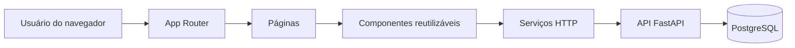

# Arquitetura da Interface

## Visão Geral

A interface usa Next.js 16 com App Router, React 19 e TypeScript estrito. As rotas são componentes de página em `frontend/src/app`; componentes reutilizáveis ficam em `frontend/src/components`; e o acesso à API fica em `frontend/src/services`.

## Árvore de Rotas

| Rota | Arquivo | Responsabilidade |
|---|---|---|
| `/` | `frontend/src/app/page.tsx` | Página inicial e navegação principal |
| `/login` | `frontend/src/app/login/page.tsx` | Autenticação |
| `/cadastro` | `frontend/src/app/cadastro/page.tsx` | Cadastro de usuário |
| `/perfil` | `frontend/src/app/perfil/page.tsx` | Perfil acadêmico e importação de histórico escolar SIGAA (PDF) |
| `/cursos` | `frontend/src/app/cursos/page.tsx` | Catálogo de cursos |
| `/cursos/[slug]` | `frontend/src/app/cursos/[slug]/page.tsx` | Detalhes de um curso |
| `/disciplinas` | `frontend/src/app/disciplinas/page.tsx` | Catálogo de disciplinas |
| `/disciplinas/[slug]` | `frontend/src/app/disciplinas/[slug]/page.tsx` | Métricas, turmas, materiais e colaboração da disciplina |
| `/minha-grade` | `frontend/src/app/minha-grade/page.tsx` | Planejamento de grade horária, verificação de conflitos e exportação em PDF |
| `/moderacao` | `frontend/src/app/moderacao/page.tsx` | Curadoria de materiais e denúncias |

## Componentes Principais

| Componente | Responsabilidade |
|---|---|
| `Navbar` | Navegação, sessão e atalhos principais (`Início`, `Cursos`, `Disciplinas`, `Minha grade`) |
| `ThemeSelector` | Alternância de tema claro/escuro na barra de navegação |
| `Footer` | Informações institucionais e navegação secundária |
| `OpenDataExportBar` | Barra de exportação de dados abertos em CSV e JSON (RF06) |
| `PasAdmissionCard` | Resumo e histórico das notas de corte do PAS (Cebraspe) |
| `ClassFilters` | Filtros por turno e ordenação de turmas |
| `ClassCard` | Representação de turma, horário e ocupação |
| `ClassPerformancePieForm` | Doação colaborativa e visualização percentual de turmas (Quórum) |
| `GradeCalendar` | Grade horária semanal interativa e visualização de choques em `/minha-grade` |
| `MateriaisApoio` | Listagem, busca e download autenticado de materiais da disciplina |
| `MaterialModal` | Envio de arquivos ou links para uma disciplina |
| `ComentariosFrontend` | Relatos discentes sob pseudônimo, threads aninhadas e denúncias |
| `DificuldadesPanel` | Dificuldades e comentários acadêmicos por tópico |
| `AcademicProfileDashboard` | Dashboard do perfil acadêmico com leitura de histórico SIGAA importado |
| `ModerationCard` | Decisão sobre materiais pendentes |
| `CommentModerationCard` | Decisão sobre comentários pendentes na fila de curadoria |
| `DenunciaModerationCard` | Visualização e decisão sobre denúncias |
| `ModerationActionModal` | Confirmação de ações de moderação |

## Fluxo de Dados

1. A página recebe parâmetros de rota e estado de URL.
2. O componente solicita dados por uma função em `frontend/src/services`.
3. O serviço usa `httpClient` e envia o token quando a rota exige autenticação.
4. A página trata estados de carregamento, sucesso, erro e fallback.
5. Componentes apresentam os dados sem executar consultas ou regras de persistência.

## Estados Relevantes

- Carregamento: esqueleto ou indicador acessível.
- Sucesso: dados reais ou feedback de operação concluída.
- Erro: mensagem compreensível e ação de tentar novamente quando aplicável.
- Sem dados: estado vazio sem dados mockados apresentados como reais.
- Não autenticado: redirecionamento ou bloqueio de ações protegidas.
