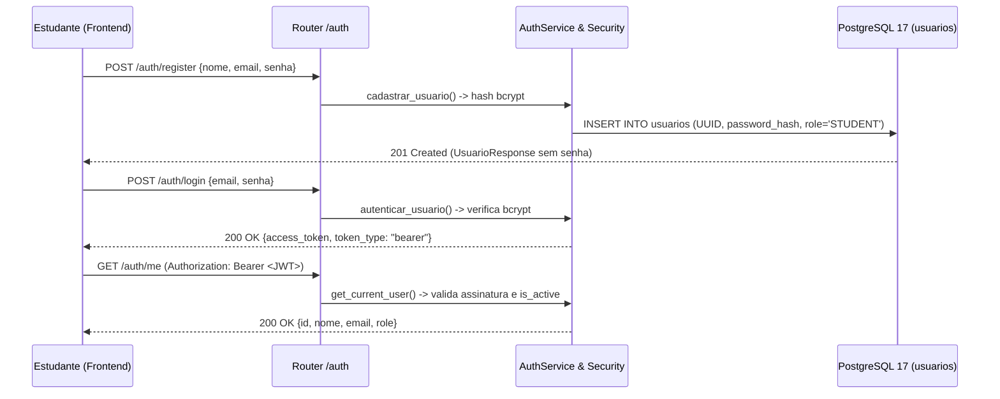

# Autenticação, Segurança (LGPD) e Comentários da Comunidade

Documentação técnica dos módulos de **Autenticação e Controle de Acesso (Épico 1)** e **Relatos e Comentários da Comunidade (Épico 5 — Feature 5.1)**, detalhando a arquitetura stateless via JWT, a proteção de privacidade discente (*Privacy by Design* — RN01 / ADR 05), o controle de acesso baseado em perfis (RBAC) e a estrutura de comentários aninhados sob pseudônimo.

---

## 1. Privacidade por Padrão (*Privacy by Design* — RN01 e ADR 05)

Em conformidade com a Lei Geral de Proteção de Dados (LGPD) e com a **ADR 05**, o módulo de identidade e comunidade aplica três garantias estruturais:

1. **Coleta Mínima no Cadastro (RF01):** a tabela `usuarios` armazena exclusivamente `id` (UUID v4 não sequencial), `nome`, `email`, `password_hash` (bcrypt), `role` e `is_active`. O sistema **não** solicita nem persiste matrícula institucional, CPF, IRA ou histórico escolar nominal.
2. **Desvinculação Pública de Identidade nos Relatos (RF12 / RN01):** na tabela `comentarios`, o campo `usuario_id` é utilizado exclusivamente para controle interno de autoria (permitindo edição/exclusão pelo próprio autor e auditoria de denúncias), enquanto a API pública serializa apenas o pseudônimo (`autor_alias`, padrão `'Estudante Anônimo'`).
3. **Desativação Lógica com Preservação Estatística (US 1.1.3):** ao solicitar a exclusão da própria conta (`DELETE /auth/me`), a conta é desativada (`is_active = False`), impedindo novos logins sem corromper as estatísticas agregadas e contribuições históricas da comunidade.

---

## 2. Arquitetura de Autenticação Stateless (JWT) e RBAC

### Perfis de Acesso (RBAC)

A coluna `role` em `usuarios` possui restrição `CHECK (role IN ('STUDENT', 'MODERATOR', 'ADMIN'))`:

* **`STUDENT`:** perfil padrão atribuído no cadastro público. Permite registrar situação acadêmica ("Já cursei"), doar estatísticas de turmas, enviar materiais, publicar/editar/excluir seus próprios comentários, votar (`upvotes`) e registrar denúncias.
* **`MODERATOR` e `ADMIN`:** perfis administrativos validados pelas dependências de segurança em `app/api/deps.py`, autorizados a acessar e deliberar nas filas `/moderacao/materiais` e `/moderacao/denuncias`.

### Contratos do Módulo `/auth` (`backend/app/api/routers/auth.py`)

| Método | Rota | Autenticação | Status de Sucesso | Descrição |
| :--- | :--- | :--- | :--- | :--- |
| `POST` | `/auth/register` | Pública | `201 Created` | Cadastra novo usuário com validação de força de senha e unicidade de e-mail (`400`/`409` se duplicado). |
| `POST` | `/auth/login` | Pública | `200 OK` | Valida credenciais contra hash bcrypt e emite token JWT assinado (`401` se inválido ou inativo). |
| `GET` | `/auth/me` | Bearer JWT | `200 OK` | Retorna os dados cadastrais do usuário autenticado a partir do token ativo. |
| `DELETE` | `/auth/me` | Bearer JWT | `200 OK` | Desativa logicamente a conta do próprio usuário autenticado (US 1.1.3). |

---

## 3. Comentários e Discussões sob Pseudônimo (Feature 5.1)

Os relatos comunitários permitem que estudantes compartilhem experiências, dicas e dificuldades por disciplina ou turma específica, com suporte a respostas encadeadas em árvore (*threads*) via auto-relacionamento `parent_id` na tabela `comentarios`.

### Ciclo de Vida e Triagem Híbrida (RN04 e RN06)

1. **Criação (`POST /comentarios`) e Edição (`PATCH /comentarios/{comentario_id}`):**
   * Exigem token JWT válido (`Depends(get_current_user)`).
   * Na edição ou exclusão (`DELETE /comentarios/{comentario_id}`), o serviço verifica estritamente se `comentario.usuario_id == current_user.id` (retornando `403 Forbidden` caso outro usuário tente modificar o relato).
   * Novos comentários e edições acionam em segundo plano (`BackgroundTasks`) a rotina `processar_moderacao_comentario_bg` (`ModeracaoIAService`), combinando filtros determinísticos de dados pessoais (RN01) e conduta ética/proteção a docentes (RN04) com inferência local via Ollama (RF16).
2. **Listagem Pública (`GET /cadeiras/{id}/comentarios`):**
   * Exibe apenas relatos com `status_moderacao = 'PUBLICADO'`, ordenados cronologicamente e estruturados com suas respostas filhas (`parent_id`), expondo apenas `autor_alias` sem revelar `usuario_id` ou e-mail.
3. **Denúncias Comunitárias (`POST /comentarios/{comentario_id}/denuncias`):**
   * Permite que qualquer estudante autenticado sinalize um comentário por `OFENSA_DOCENTE`, `CONTEUDO_IMPROPRIO`, `GABARITO_ATIVO`, `SPAM` ou `OUTRO`.
   * Ao atingir o limiar de 3 denúncias pendentes (`LIMIAR_OCULTACAO_DENUNCIAS = 3`), o comentário sofre retenção preventiva automática até revisão humana no painel `/moderacao`.

### Contratos do Módulo `/comentarios` (`backend/app/api/routers/comentarios.py`)

| Método | Rota | Autenticação | Status | Descrição |
| :--- | :--- | :--- | :--- | :--- |
| `POST` | `/comentarios` | Bearer JWT | `201 Created` | Cria comentário vinculado à disciplina (e opcionalmente turma ou `parent_id`) e agenda triagem assíncrona. |
| `PATCH` | `/comentarios/{comentario_id}` | Bearer JWT (Autor) | `200 OK` | Atualiza o texto do próprio comentário e agenda revalidação automática de moderação. |
| `DELETE` | `/comentarios/{comentario_id}` | Bearer JWT (Autor) | `204 No Content` | Remove o próprio comentário (e respostas filhas via `ON DELETE CASCADE`). |
| `POST` | `/comentarios/{comentario_id}/denuncias` | Bearer JWT | `201 Created` | Registra denúncia fundamentada contra o comentário (retorna `409 Conflict` se o usuário já denunciou o mesmo item). |
