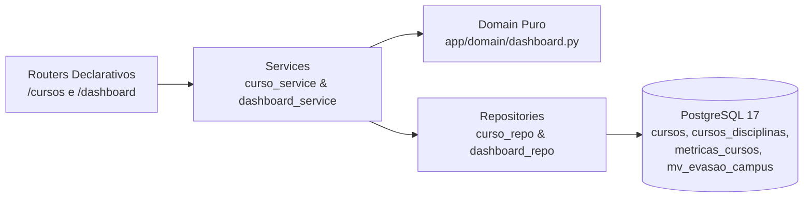

# Dashboard Institucional e Métricas Agregadas (Épico 6)

Documentação técnica das entregas do **Épico 6 — Dashboard Institucional (Curso e Campus)**, compreendendo a consulta de grade curricular organizada por período (US 6.1.1), a série histórica e taxa média de formação por curso (US 6.2.1), a taxa de evasão agregada por campus via Visão Materializada no PostgreSQL 17 (US 6.2.2) e o endpoint consolidado de visão geral institucional da UnB (US 6.2.3).

---

## 1. Visão Arquitetural e Decisões Técnicas

A implementação segue estritamente a **Clean Architecture** em 4 camadas e as Decisões Arquiteturais Registradas do projeto:

* **Domínio Puro (`backend/app/domain/dashboard.py`):** encapsula as fórmulas matemáticas de cálculo percentual (`calcular_taxa_formacao`, `calcular_taxa_evasao` e `calcular_media`) com proteção contra divisão por zero (`denominador == 0` retorna `None`) e rejeição de valores negativos.
* **Visão Materializada sem Cache Externo (ADR 01):** em conformidade com a ADR 01 (que veda o uso de Redis ou servidores externos de cache), a agregação de evasão por campus é pré-computada no PostgreSQL 17 por meio da *Materialized View* `mv_evasao_campus` (migração `014_mv_evasao_campus`), garantindo respostas em menos de 300 ms (RNF01) com índice único `ux_mv_evasao_campus_campus_ano`.
* **Contratos Pydantic v2 (`backend/app/api/schemas/dashboard.py`):** validação estrita de contagens e taxas não negativas com `PydanticCustomError` em português.



---

## 2. Componentes por Camada

| Camada | Arquivo | Responsabilidade |
| :--- | :--- | :--- |
| **Domínio** | `backend/app/domain/dashboard.py` | Fórmulas puras de taxa de formação, taxa de evasão (RN08) e média aritmética arredondadas em 2 casas decimais. |
| **Schemas** | `backend/app/api/schemas/dashboard.py`<br/>`backend/app/api/schemas/curso.py` | Contratos `CursoGradeResponse`, `CursoFormacaoResponse`, `EvasaoCampusComparativoResponse`, `EvasaoCampusDetalheResponse` e `DashboardGeralResponse`. |
| **Migração** | `backend/alembic/versions/014_create_mv_evasao_campus.py` | Criação da visão materializada `mv_evasao_campus` e índice único composto `(campus, ano)`. |
| **Repositórios** | `backend/app/repositories/dashboard_repo.py`<br/>`backend/app/repositories/curso_repo.py` | Consultas agregadas sobre `metricas_cursos`, `mv_evasao_campus` e junção curricular `cursos_disciplinas`. |
| **Serviços** | `backend/app/services/dashboard_service.py`<br/>`backend/app/services/curso_service.py` | Orquestração dos indicadores, tratamento de dados ausentes (HTTP 404) e falhas de banco (`SQLAlchemyError` -> HTTP 503). |
| **Routers** | `backend/app/api/routers/dashboard.py`<br/>`backend/app/api/routers/cursos.py` | Exposição pública (`GET`) dos endpoints analíticos e curriculares. |

---

## 3. Fórmulas de Domínio

As métricas institucionais calculadas em `app/domain/dashboard.py` seguem as definições oficiais do projeto (RN08):

1. **Taxa de Formação por Período/Curso:**
   $$\text{Taxa de Formação (\%)} = \text{round}\left(\frac{\text{Concluintes}}{\text{Ingressantes}} \times 100,\ 2\right)$$
   *(Retorna `null` quando `ingressantes == 0`.)*

2. **Taxa de Evasão Institucional (RN08):**
   $$\text{Taxa de Evasão (\%)} = \text{round}\left(\frac{\text{Desvinculados}}{\text{Matriculados Ativos}} \times 100,\ 2\right)$$
   *(Retorna `null` quando `matriculados == 0`.)*

---

## 4. Contratos HTTP dos Endpoints

Todas as rotas de leitura do dashboard e catálogo de cursos são públicas (acessíveis por visitantes e estudantes autenticados).

### 4.1. US 6.1.1 — Grade Curricular do Curso por Período
* **Rota:** `GET /cursos/{curso_id}/grade`
* **Descrição:** retorna os metadados do curso e suas disciplinas agrupadas cronologicamente por `periodo_sugerido` (incluindo disciplinas obrigatórias e optativas).
* **Respostas:**
  * `200 OK`: matriz curricular agrupada por período (retorna lista vazia controlada se o curso não possuir disciplinas vinculadas).
  * `404 Not Found`: curso inexistente para o `curso_id` informado.

### 4.2. US 6.2.1 — Taxa Média e Série Histórica de Formação por Curso
* **Rota:** `GET /dashboard/cursos/{identificador}/formacao`
* **Parâmetros:** `identificador` aceita tanto o `id` numérico quanto o `slug` do curso (ex.: `engenharia-de-software`).
* **Exemplo de Resposta (`200 OK`):**
  ```json
  {
    "curso_id": 1,
    "curso_nome": "Engenharia de Software",
    "curso_slug": "engenharia-de-software",
    "taxa_media_formacao": 29.85,
    "serie_historica": [
      {
        "ano": 2023,
        "ingressantes": 120,
        "matriculados": 480,
        "concluintes": 36,
        "taxa_formacao": 30.0
      }
    ]
  }
  ```
* **Erros:** `404 Not Found` caso o curso não exista ou não possua dados públicos suficientes de formação.

### 4.3. US 6.2.2 — Taxa de Evasão Agregada por Campus (`mv_evasao_campus`)
* **Rotas:**
  * `GET /dashboard/campus/evasao?campus={filtro_opcional}` — lista comparativa de evasão agregada entre os campi da UnB.
  * `GET /dashboard/campus/{campus}/evasao` — detalhe e série histórica anual de evasão de um campus específico.
* **Fonte de Dados:** visão materializada `mv_evasao_campus`, atualizável no PostgreSQL via `REFRESH MATERIALIZED VIEW CONCURRENTLY mv_evasao_campus`.
* **Erros:** `404 Not Found` para campus inexistente; `503 Service Unavailable` caso a visão materializada esteja temporariamente indisponível.

### 4.4. US 6.2.3 — Visão Geral do Dashboard Institucional
* **Rota:** `GET /dashboard/geral`
* **Descrição:** consolida em uma única resposta rápida os totais institucionais da UnB (`total_cursos`, `total_campi`, `ingressantes`, `matriculados`, `concluintes`, `trancados`, `evadidos`), as taxas médias globais (`taxa_media_formacao` e `taxa_media_evasao`), o resumo comparativo por campus (`resumo_campi`) e a série histórica de fluxo estudantil (`fluxo_estudantes`).
* **Exemplo de Resposta (`200 OK`):**
  ```json
  {
    "total_cursos": 6,
    "total_campi": 4,
    "ingressantes": 1250,
    "matriculados": 5400,
    "concluintes": 380,
    "trancados": 410,
    "evadidos": 270,
    "taxa_media_formacao": 30.4,
    "taxa_media_evasao": 5.0,
    "resumo_campi": [
      {
        "campus": "FCTE - Gama",
        "matriculados": 1800,
        "desvinculados": 90,
        "taxa_evasao": 5.0,
        "taxa_media_anual": 5.0
      }
    ],
    "fluxo_estudantes": [
      {
        "ano": 2024,
        "ingressantes": 1250,
        "matriculados": 5400,
        "concluintes": 380,
        "trancados": 410,
        "evadidos": 270,
        "taxa_formacao": 30.4,
        "taxa_evasao": 5.0
      }
    ]
  }
  ```
* **Erros:** `404 Not Found` quando ainda não há dados consolidados carregados; `503 Service Unavailable` em caso de indisponibilidade transacional das visões ou tabelas analíticas.

---

## 5. Verificação e Testes Automatizados

Os cenários unitários (domínio, schemas e serviços com mocks) e de integração (PostgreSQL 17 real com migração `014_mv_evasao_campus`) podem ser executados via Docker:

```bash
docker compose exec backend pytest tests/unit/test_dashboard_domain.py tests/unit/test_dashboard_schemas.py tests/unit/test_dashboard_service.py tests/integration/dashboard/test_dashboard.py -v
```
