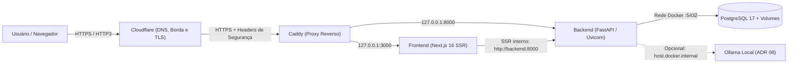

# Estratégia de Deploy e Produção

Este documento descreve a arquitetura de implantação em produção, os controles de segurança aplicados e os procedimentos operacionais do **Tamburetei UnB** no ar em **[tambureteiunb.com.br](https://tambureteiunb.com.br/)**.

---

## 1. Endereços Oficiais Publicados

| Serviço | URL Pública | Observações |
| :--- | :--- | :--- |
| **Aplicação Web (Frontend)** | [https://tambureteiunb.com.br](https://tambureteiunb.com.br/) | Portal Next.js 16 servido em `NODE_ENV=production` (também responde em `www.tambureteiunb.com.br`). |
| **API RESTful (Backend)** | [https://api.tambureteiunb.com.br](https://api.tambureteiunb.com.br/health) | FastAPI / Uvicorn com validação de saúde em `GET /health` (`{"status":"ok"}`). |
| **Portal de Documentação** | [https://unb-mds.github.io/2026-02-TambureteiUnB/](https://unb-mds.github.io/2026-02-TambureteiUnB/) | Site estático MkDocs Material publicado automaticamente via GitHub Pages na branch `main`. |

---

## 2. Topologia de Infraestrutura e Rede

A aplicação roda conteinerizada com [`docker-compose.prod.yml`](https://github.com/unb-mds/2026-02-TambureteiUnB/blob/develop/docker-compose.prod.yml) atrás de uma camada dupla de proteção (DNS/CDN na borda + proxy reverso TLS local):



### Detalhamento dos Serviços de Produção

| Contêiner / Camada | Build / Imagem | Porta e Vínculo | Responsabilidade e Persistência |
| :--- | :--- | :--- | :--- |
| **Borda e Proxy Reverso** | Cloudflare + Caddy | `443` (HTTPS público) | Terminação TLS, roteamento dos subdomínios `tambureteiunb.com.br` / `api.tambureteiunb.com.br` e injeção de cabeçalhos HTTP de segurança. |
| **`frontend` (Next.js 16)** | [`frontend/Dockerfile`](https://github.com/unb-mds/2026-02-TambureteiUnB/blob/develop/frontend/Dockerfile) (*multi-stage* `node:20-alpine`) | `127.0.0.1:3000` (apenas loopback) | Compilado com `NEXT_PUBLIC_API_URL=https://api.tambureteiunb.com.br`; usa `BACKEND_INTERNAL_URL=http://backend:8000` para chamadas internas SSR na rede Docker. |
| **`backend` (FastAPI)** | [`backend/Dockerfile`](https://github.com/unb-mds/2026-02-TambureteiUnB/blob/develop/backend/Dockerfile) (`python:3.12-slim`) | `127.0.0.1:8000` (apenas loopback) | Executa `uvicorn app.main:app --host 0.0.0.0 --port 8000 --workers 1` e monta os volumes persistentes `materiais_data` (`/app/storage/materiais`) e `pizzas_data` (`/app/storage/pizzas`). |
| **`db` (PostgreSQL 17)** | `postgres:17` | Rede interna Docker (`5432`, sem exposição externa) | Inicializa via `init.sql`, valida saúde com `pg_isready` (`interval: 10s`, `retries: 5`) e persiste dados no volume `pgdata`. |

---

## 3. Segurança e Hardening em Produção

As configurações de produção aplicam proteção em múltiplas camadas ([`docker-compose.prod.yml`](https://github.com/unb-mds/2026-02-TambureteiUnB/blob/develop/docker-compose.prod.yml), [`backend/app/core/config.py`](https://github.com/unb-mds/2026-02-TambureteiUnB/blob/develop/backend/app/core/config.py) e [`backend/app/main.py`](https://github.com/unb-mds/2026-02-TambureteiUnB/blob/develop/backend/app/main.py)):

1. **Isolamento de Portas no Host:** nem `frontend` (`127.0.0.1:3000`), nem `backend` (`127.0.0.1:8000`), nem `db` ficam expostos diretamente na rede pública; todo tráfego externo entra obrigatoriamente pelo proxy HTTPS (Cloudflare + Caddy).
2. **Cabeçalhos HTTP de Proteção:** respostas em produção incluem `Content-Security-Policy: frame-ancestors 'none'`, `X-Frame-Options: DENY`, `X-Content-Type-Options: nosniff`, `Referrer-Policy: strict-origin-when-cross-origin` e `Permissions-Policy: geolocation=(), microphone=(), camera=()`.
3. **Bloqueio de Swagger Público e Segredos Fortes:** quando `ENVIRONMENT=production`, a API desativa `/docs`, `/redoc` e `/openapi.json` e bloqueia a inicialização caso `SECRET_KEY` seja padrão ou tenha menos de 32 caracteres.
4. **CORS Restrito:** `BACKEND_CORS_ORIGINS` aceita apenas as origens oficiais HTTPS (`https://tambureteiunb.com.br` e `https://www.tambureteiunb.com.br`), proibindo curingas (`*`).
5. **E-mail Transacional e IA Resiliente:** envio de recuperação de senha via SMTP autenticado (`tambureteiunb@gmail.com`) com `FRONTEND_URL=https://tambureteiunb.com.br`; caso `OLLAMA_BASE_URL` não esteja configurado no servidor, o sistema degrada graciosamente mantendo novas submissões em fila humana `/moderacao` (`RNF08` / ADR 08).

---

## 4. Fluxo de Atualização, Migrações e Documentação

### Banco de Dados e Subida da Aplicação
Na inicialização do contêiner `backend`, o script [`backend/entrypoint.sh`](https://github.com/unb-mds/2026-02-TambureteiUnB/blob/develop/backend/entrypoint.sh) aguarda o serviço `db` responder e executa automaticamente **`alembic upgrade head`** antes de subir o servidor FastAPI (ADR 02 — *Database-as-Code*).

```bash
# Subida / reconstrução do ambiente de produção
docker compose -f docker-compose.prod.yml --env-file .env.production up -d --build
```

### Publicação Automática da Documentação (GitHub Pages)
O portal MkDocs é publicado de forma independente pelo workflow [`.github/workflows/deploy-docs.yml`](https://github.com/unb-mds/2026-02-TambureteiUnB/blob/develop/.github/workflows/deploy-docs.yml) sempre que alterações em `docs/**` ou `mkdocs.yml` são integradas à branch **`main`**:
1. Executa `mkdocs build --strict` garantindo ausência de links quebrados ou avisos de configuração.
2. Publica os artefatos estáticos automaticamente no ambiente `github-pages`.
