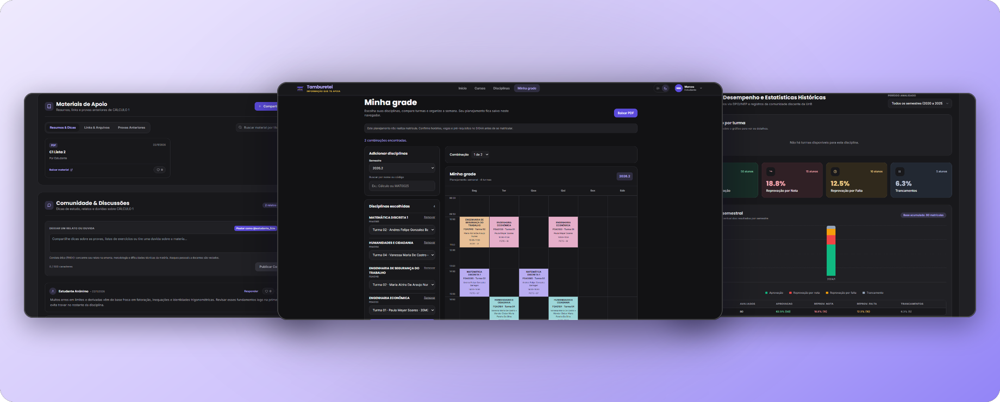
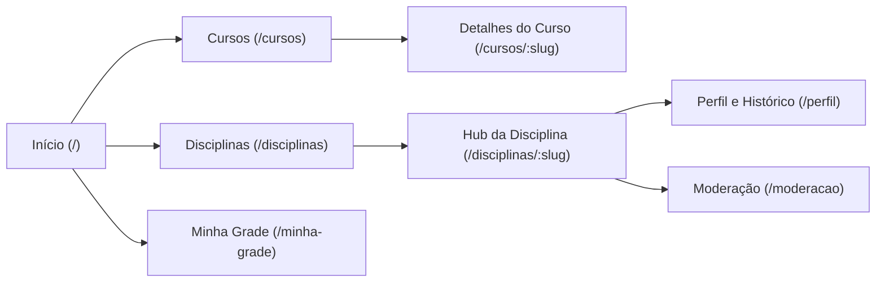

# Documentação Tamburetei UnB

Guias de arquitetura, dados, APIs REST e fluxos colaborativos da plataforma acadêmica da **FCTE/UnB**.

* **Aplicação em Produção:** [tambureteiunb.com.br](https://tambureteiunb.com.br/disciplinas)
* **Repositório Oficial:** [unb-mds/2026-02-TambureteiUnB](https://github.com/unb-mds/2026-02-TambureteiUnB)

-   **[Setup & Execução](comecando/desenvolvimento.md)**

    Suba os containers Docker, configure o `.env` e rode os testes.

-   **[Arquitetura & ADRs](engenharia/arquitetura.md)**

    Clean Architecture em 4 camadas e decisões técnicas (ADRs).

-   **[Requisitos do Sistema](produto/requisitos.md)**

    Requisitos funcionais, não funcionais e escopo da plataforma.

-   **[Histórias de Usuário](produto/historias_usuario_backend.md)**

    Backlog técnico, critérios de aceitação e entregas por camada.

-   **[Dicionário de Dados](engenharia/banco_de_dados.md)**

    Esquema PostgreSQL 17, relacionamentos e migrações Alembic.

-   **[AI Usage & Skills](ai/ai_usage.md)**

    Governança de agentes, fluxo TDD e revisão humana.

## Propósito do Sistema

O **Tamburetei UnB** é desenvolvido pelo **Grupo G9** (MDS 2026/2) com inspiração no OpenDevUFCG para atender a três necessidades centrais da comunidade universitária:

  

*Interface do Tamburetei UnB: repositório colaborativo de materiais e discussões, planejamento semanal de grade e painel de desempenho histórico.*

### 1. Transparência e Métricas Acadêmicas

Ingestão, normalização e disponibilização pública de indicadores históricos da UnB (DPO, INEP e LAI):

* **Taxas de aprovação** por disciplina, curso e departamento;
* **Índices de reprovação** por nota e por falta/frequência;
* **Trancamentos e retenção** curricular ao longo dos semestres;
* **Taxas de evasão** institucional por curso e campus;
* **Tempo médio e taxa de formação** por curso.

### 2. Hub Colaborativo de Disciplinas (`/disciplinas/[slug]`)

Centralização de materiais pedagógicos organizados modularmente por matéria (interface web em `/disciplinas/[slug]`, consumindo a API `/cadeiras/{slug}`):

* Ementas oficiais, carga horária e créditos;
* Dificuldades comuns e tópicos conceituais críticos;
* Dicas de estudo e metodologias de aprovação;
* Resumos e notas de aula compartilhados (*"leites"*);
* Curadoria de links úteis (playlists, livros e repositórios de exercícios);
* Enunciados de avaliações públicas anteriores.

### 3. Crowdsourcing e Experiência Discente ("Já cursei")

Espaço anônimo e seguro para a vivência dos estudantes:

* **Registro de Situação Acadêmica:** o aluno autenticado indica se foi *Aprovado*, *Reprovado por Nota*, *Reprovado por Falta* ou *Trancou* a disciplina, alimentando as estatísticas consolidadas por quórum;
* **Comentários Anônimos/Pseudônimos:** relatos acadêmicos preservando a privacidade individual e a liberdade de expressão;
* **Moderação e Curadoria:** revisão comunitária de denúncias com ocultação preventiva e fila administrativa.

---

## Fluxo Principal de Navegação

* **Descoberta acadêmica (`/`, `/cursos` e `/cursos/[slug]`):** acesso livre ao panorama institucional, filtros por campus, grade curricular, taxas de formação/evasão e notas de corte do PAS.
* **Exploração e colaboração (`/disciplinas` e `/disciplinas/[slug]`):** busca por nome ou código, ementa oficial, histórico de aprovação/reprovação, turmas ofertadas, exportação em CSV/JSON, materiais de apoio e discussões sob pseudônimo.
* **Organização pessoal (`/minha-grade` e `/perfil`):** planejamento semanal de horários com detecção de conflitos, exportação em PDF e importação de histórico escolar do SIGAA.
* **Curadoria e governança (`/moderacao`):** fila dedicada a moderadores e administradores para análise de materiais, comentários e denúncias.

---

## Cronograma e Entregas (Releases)

| Release / Entrega | Data | Foco Principal | Entregáveis Técnicos |
| :--- | :--- | :--- | :--- |
| **Release 1 (R1 - v0.1.0)** | 28/09/2026 | Engenharia de Dados, Infraestrutura & Modelagem | Pipeline ETL conteinerizado em Docker, anonimização LGPD (Privacy by Design), dataset limpo e modelos relacionais no PostgreSQL 17 versionados com Alembic. |
| **Release v0.6.0 (Sprint 6)** | 23/10/2026 | Integração de Turmas, Doações & Padronização FCTE | Conexão de dados reais de turmas e métricas no frontend, endpoint de doação estatística (`POST /turmas/{id}/doacoes`), migração 008, dicionário de dados oficial e identidade FCTE. |
| **Release v0.7.0 (Sprint 7)** | 30/10/2026 | Materiais de Apoio, Quórum, Grade Curricular & CI | Modal de upload multipart e seção de materiais de apoio, motor de consenso por quórum e estatística consolidada (migração 012), grade curricular, taxa de formação e pipeline unificado de CI/CD. |
| **Release v0.8.0 (Sprint 8)** | 06/11/2026 | Dificuldades na Ementa, Curadoria & Interatividade | Painel de dificuldades e tópicos críticos da ementa, curadoria administrativa de arquivos com auditoria, respostas em comentários e contador "Já cursei". |
| **Release v0.9.0 (Sprint 9)** | 13/11/2026 | Central de Denúncias (RN04) & Painel de Moderação | Fluxo completo de denúncias comunitárias com ocultação preventiva por limiar, migração 011 e Painel de Ações em `/moderacao`. |
| **Release v0.10.0 (Sprint 10)** | 20/11/2026 | Estatísticas Consolidadas, Dados Abertos & Acessibilidade | Série histórica por intervalo de anos, ocupação real de turmas, exportação CSV/JSON (`RF06`), página de turmas ofertadas e validação de acessibilidade. |
| **Release 2 (R2)** | Semana 15 — 25/11/2026 | Portal Web & Hub Comunitário | Frontend em Next.js (App Router), dashboards analíticos interativos, hub de disciplinas (`/disciplinas/[slug]`), moderação de relatos e pipeline CI/CD com SAST. |

---

## Stack Tecnológica

* **Backend:** Python 3.12+, FastAPI, Pydantic v2 e SQLAlchemy 2.0.
* **Banco de Dados:** PostgreSQL 17 gerenciado via Docker e migrações versionadas com Alembic (*Database-as-Code*).
* **Frontend:** Next.js (App Router), React, TypeScript e Tailwind CSS.
* **Qualidade & Testes:** Pytest, Mutmut (testes de mutação), Ruff, Bandit e SonarQube (SAST).
* **Infraestrutura:** Docker e Docker Compose para execução isolada e reprodutível.
