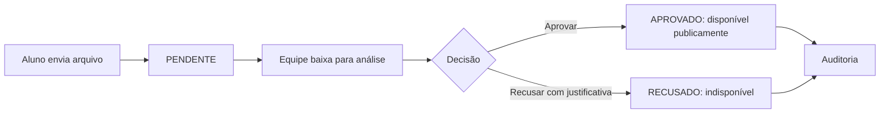
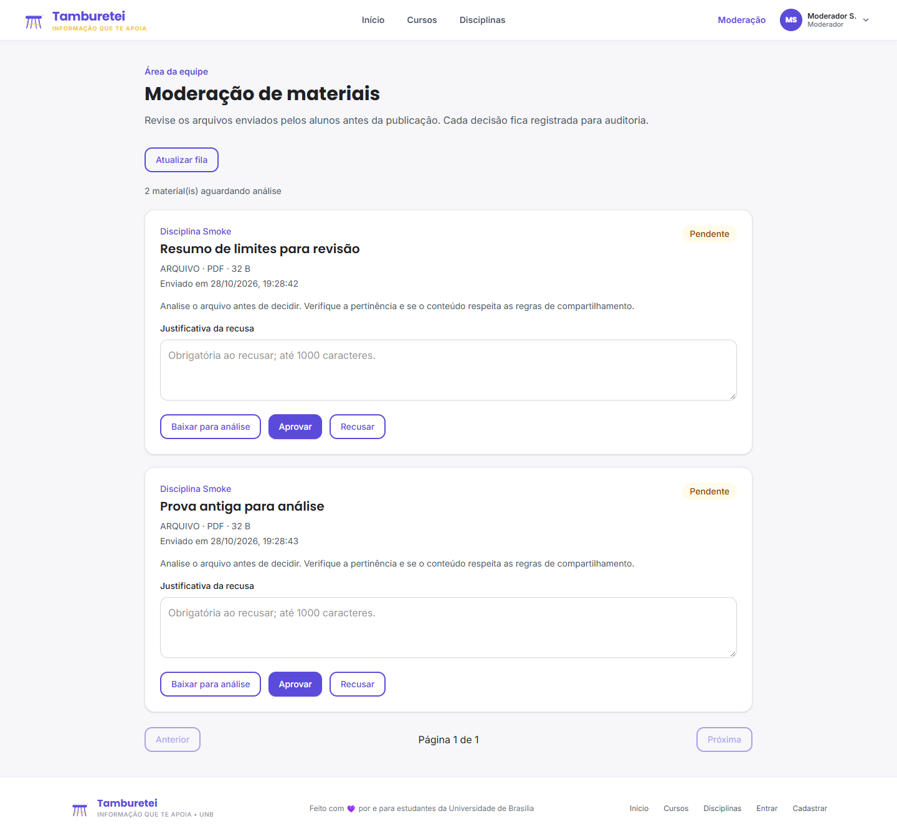
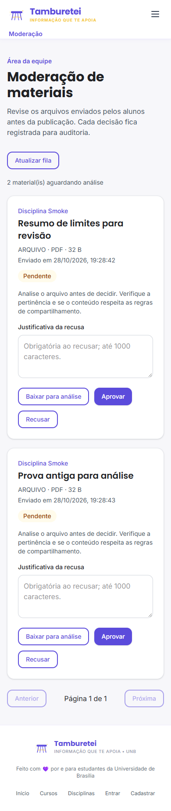

# Moderação e curadoria de arquivos

Implementação local de RF12/RF15 e da curadoria da US 5.3.2, na branch `feat/moderacao-curadoria`, baseada em `develop` (`fbb9361`). Escopo: arquivos enviados por alunos. Moderação de comentários, denúncias e revisão de decisões anteriores não fazem parte desta entrega.

## Fluxo



Os arquivos permanecem em `conteudos`, com as categorias existentes e metadados privados. Novos uploads começam como `PENDENTE`; o estado técnico de moderação pode continuar `ativo`, mas isso não os publica. Listagem e download públicos exigem curadoria `APROVADO` e moderação `ativo`. Arquivos já aprovados antes desta entrega não são reclassificados.

A interface de envio informa que o material aguarda aprovação. O upload continua restrito a `STUDENT` e os limites de formato e tamanho são preservados.

## Página /moderacao

A página consulta `/auth/me` e autoriza apenas `MODERATOR` e `ADMIN`. O cache de perfil no navegador não concede acesso. A autorização definitiva ocorre no backend em cada operação, consultando o perfil atual e a atividade da conta.

A fila contém arquivos pendentes, ordenados por envio e ID, em páginas de 20. Mostra título, disciplina, categoria, formato, tamanho e data, sem identidade do aluno nem caminho físico. Permite baixar para análise, aprovar ou recusar. A recusa exige justificativa de até 1000 caracteres. Conflitos de avaliação atualizam a fila sem repetir a decisão. Há estados de carregamento, erro, acesso negado e fila vazia, além de layout para celular.



## Contratos protegidos

| Método | Rota | Resultado |
| --- | --- | --- |
| GET | `/moderacao/materiais?pagina=1&tamanho_pagina=20` | Fila paginada de arquivos pendentes. |
| GET | `/moderacao/materiais/{id}/download` | Download privado para análise de arquivo pendente. |
| PATCH | `/moderacao/conteudos/{id}/curadoria` | Decisão e registro de auditoria. |
| GET | `/moderacao/conteudos/{id}/historico` | Histórico administrativo do arquivo. |

Exemplo de recusa:

```json
{"status": "RECUSADO", "justificativa": "Arquivo de avaliação ainda vigente."}
```

A aprovação usa `status=APROVADO`; a justificativa é opcional. Nenhuma identidade do moderador é aceita no corpo: ela vem da sessão autenticada. Respostas incluem 401 sem sessão, 403 por perfil, 404 para arquivo inexistente/excluído, 409 para decisão já concluída ou arquivo bloqueado, 422 para entrada inválida e 503 para falha transacional. Arquivos de análise são anexos com `nosniff` e `Cache-Control: private, no-store`.

## Banco e auditoria

A revisão linear `010_curadorias` sucede `009_arquivos_conteudos` e cria `curadorias`. Cada registro guarda conteúdo, ID do moderador, perfil no momento da decisão, estados anterior e novo, justificativa e data. Não armazena email, matrícula, CPF ou outros dados acadêmicos do aluno.

Estado e auditoria são gravados na mesma transação. O repositório bloqueia o conteúdo com `SELECT FOR UPDATE`; apenas a primeira decisão sobre um pendente é aceita, e as demais retornam 409. A unicidade de `conteudo_id` reforça essa regra. Não há endpoints para editar/apagar auditoria ou reabrir decisões.

A exclusão física de uma conta de moderador torna seu ID nulo, preservando perfil, decisão e data. Uma auditoria impede a exclusão física do conteúdo referenciado; exclusão lógica continua possível. O downgrade é bloqueado quando há auditoria, para não apagar registros silenciosamente.

O `init.sql` inclui a tabela e a revisão atual. Em volumes existentes, aplicar `alembic upgrade head`; não apagar volumes. O provisionamento de papéis administrativos segue o processo da equipe: cadastro público continua criando apenas alunos.

## Como verificar

```bash
docker compose --env-file .env.example -p moderacao-review up -d --build backend
docker compose --env-file .env.example -p moderacao-review exec backend pytest
cd frontend
npm ci
npm test
npx tsc --noEmit
npm run build
```

Para smoke em projeto Compose isolado, `MATERIAIS_SMOKE_TEST=1` habilita o script de testes que provisiona contas fictícias, envia arquivo, confirma o bloqueio inicial e usa a API de curadoria antes do download. Nunca executar esse provisionamento em ambiente compartilhado ou produção. As imagens desta página usam exclusivamente esses dados fictícios.

## Organização para revisão

Issue proposta: **feat(moderacao): implementar curadoria de arquivos e auditoria**.

- [x] Novos uploads pendentes e preservação dos publicados.
- [x] Fila, análise protegida, aprovação/recusa e auditoria transacional.
- [x] Página administrativa com validação da sessão.
- [x] Testes de perfis, rollback, decisões concorrentes e navegação.
- [ ] Revisar a entrega local e autorizar publicação.
- [ ] Criar a issue e a PR para develop após autorização.

Nenhum workflow novo foi criado ou alterado, conforme solicitado. Validação local concluída:

- 297 testes do backend aprovados em Docker/PostgreSQL 17.
- 100% de cobertura nos módulos novos selecionados: rotas, schemas, serviço e repositório de curadoria. Isso não representa cobertura de todo o backend.
- Teste com duas sessões concorrentes: uma decisão aceita, outra 409, apenas uma auditoria.
- Falhas de gravação e commit reverteram a decisão e não deixaram auditoria parcial.
- Downgrade com histórico existente foi bloqueado. Bootstrap e migração geraram estrutura de auditoria equivalente.
- 20 testes de serviços e validações do frontend aprovados, incluindo oito de moderação.
- TypeScript, ESLint dos arquivos novos e build de produção do Next.js aprovados.
- Teste no navegador Chrome: anônimo, aluno com perfil ADMIN forjado no cache, moderador, download, justificativa, aprovação, recusa, fila vazia e viewport de celular.
- Ruff aprovado; Bandit sem achados médios/altos (três baixos existentes).
- Nenhum teste de mutação ou SonarQube foi executado nesta entrega.


