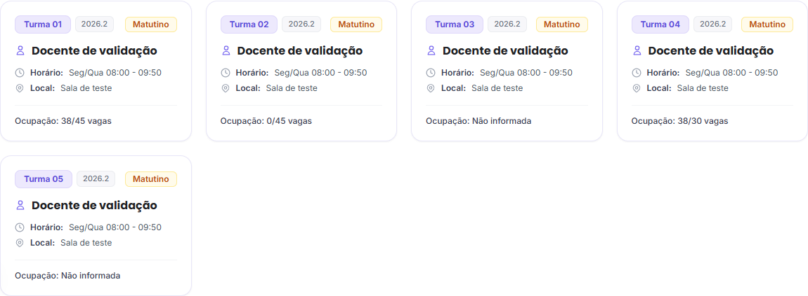

# Ocupação real das turmas — issue #178

Branch: `fix/178-ocupacao-real-turmas`. Base: `develop` (`56a78cf`).

## Problema e correção

A tabela `turmas` já possui `capacidade` e `matriculados`, mas esses campos não eram serializados por `TurmaResponse`. O adaptador do frontend preenchia a ausência com 45 vagas e zero matrículas, fazendo os cards exibirem ocupação fictícia.

O schema de resposta agora retorna ambos os valores, inclusive `null` e zero. A alteração vale para a listagem por ID/slug e para o detalhe da turma. Não há migração nem alteração nos registros, no pipeline, nas permissões ou na criação administrativa de turmas.

O frontend preserva as quantidades conhecidas e representa ausência como `null`. O card apresenta apenas o texto de ocupação, sem badge, percentual ou barra. As demais informações de professor, horário, semestre e turno são preservadas.

| Matrículas | Capacidade | Apresentação |
| --- | --- | --- |
| 38 | 45 | Ocupação: 38/45 vagas |
| 0 | 45 | Ocupação: 0/45 vagas |
| 0 | 0 | Ocupação: 0/0 vagas |
| 38 | 30 | Ocupação: 38/30 vagas |
| ausente | 45 | Ocupação: Não informada |
| 38 | ausente | Ocupação: Não informada |

Valores inválidos, como negativos ou não inteiros, também não viram quantidades inventadas. Turmas sem ocupação conhecida ficam no fim das duas ordenações por ocupação. O percentual continua sendo usado internamente na ordenação, sem aparecer no card.

## Evidências

- Backend/PostgreSQL 17: 361 testes aprovados, incluindo oito cenários novos de contrato e integração de turmas.
- Verificação de valores persistidos na listagem por ID, por slug e no detalhe, incluindo codocência sem duplicar turmas.
- Frontend: 53 testes aprovados, incluindo adaptação, ordenação e renderização do ClassCard.
- O runner continua sendo `node:test`; `tsx` foi acrescentado para executar os testes do componente com JSX.
- TypeScript e build de produção Next.js aprovados.
- ESLint: nenhum erro; dois avisos existentes sobre dependência de hook e carregamento de fonte.
- Ruff nos arquivos Python alterados: aprovado.
- Navegador Chrome com API real em Compose isolado: valores reais, zero, ausências, sobrelotação, ordenação ascendente/descendente e disposição dos cards em celular verificados.

Os dados das capturas são fictícios e foram criados somente no ambiente de validação, separado do ambiente local já existente.



[Captura em celular](assets/ocupacao-turmas-mobile.png).

## Verificação

No backend, com PostgreSQL de testes dedicado:

```bash
python -m pytest tests/integration/test_turma_service.py tests/unit/test_turma_schemas.py
```

No frontend:

```bash
npm ci
npm test
npx tsc --noEmit
npm run lint
npm run build
```

A correção mantém a arquitetura Router → Service → Repository e a persistência existente. A entrega está preparada para revisão antes de publicação.
